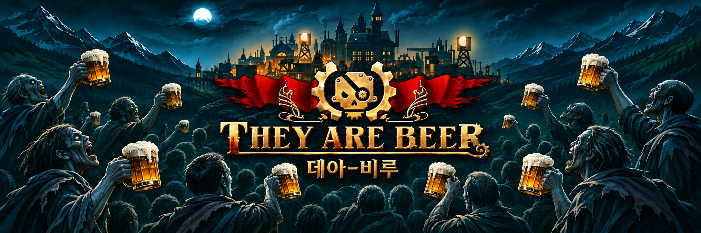
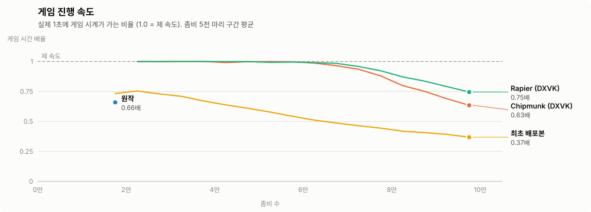
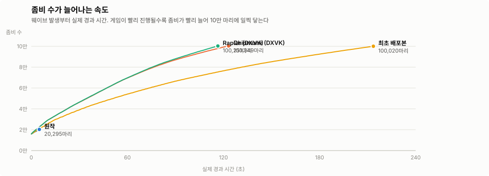
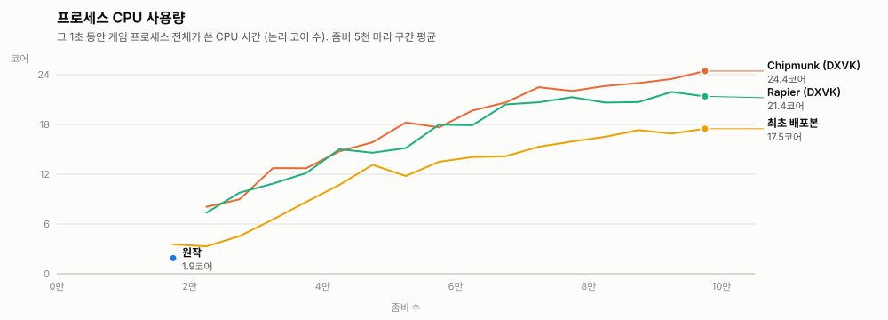

# TheyAreBeer



They Are Billions 최적화 패치

치지직 스트리머 **[똘똘똘이](https://chzzk.naver.com/1906dd57f578c255feca54700bcccfc9)** 님이 배포한 **They Are Billions 비공식 최적화 패치 모드**를 수정,개선한 소스 코드 저장소입니다. 
원본 모드 이름은 **TAB 최적화 패치(TABPerf)** 입니다.

대량의 좀비가 등장하는 장면에서 발생하는 끊김과 느려짐을 줄이는 것을 목표로 합니다. 게임 엔진을 보완하는 C# 모드와 여러 CPU 코어를 활용하는 네이티브 물리 DLL로 구성됩니다.

이 저장소에는 패치 소스와 빌드 스크립트가 들어 있습니다. 게임 본체, TABModLoader, 빌드된 설치 패키지는 포함하지 않습니다. 상세한 원본 소스 안내는 [README-SOURCE.txt](README-SOURCE.txt)를 참고하세요.

## 주요 기능

- **물리 연산:** 위치·속도 계산, 충돌 탐색, 접촉 처리를 여러 CPU 코어로 분산
- **Rapier 지원:** 선택 설정으로 물리 엔진을 Rapier 2D로 교체
- **물리 호출 최적화:** 모드 폴더의 DLL을 연결해 호출 비용을 줄임
- **작업 분배:** 논리·물리 작업을 나눠 CPU 부하를 분산
- **게임 시간:** 빠른 타이머 설정과 무관하게 게임 시계를 실제 경과 시간에 맞춰 진행
- **물리 보간:** 물리 계산 시각에 맞춰 화면 위치를 보정
- **그리기 순서:** Z 순서 변경에 따라 정렬과 갱신 주기를 조절
- **좀비 탐색:** 도달할 수 없는 대상에 대한 탐색을 생략
- **전력망:** 연결 요소를 이용해 전력 연결 여부를 계산
- **소리:** 같은 상태의 소리 장치를 반복해서 켜는 호출을 줄임
- **그리기:** 스프라이트 처리와 D3D 장치 확인 비용을 줄임
- **미니맵:** 웨이브 위치를 물리 DLL에서 한 번에 계산 (Rapier 판)
- **체력바:** 선택 옵션으로 좀비 체력바를 얇은 막대로 표시
- **DXVK (선택):** Direct3D 9를 Vulkan으로 실행하며 게임 폴더는 수정하지 않음

성능 개선 정도는 CPU, 맵, 유닛 수와 게임 상황에 따라 달라집니다.

## 최초 배포본 대비 주요 수정

최초 배포본(이 저장소의 첫 커밋 `ef035e1`)에서 바뀐 점입니다. 전체 기록은 [CHANGELOG](CHANGELOG.md)에 있습니다.

| 영역 | 최초 배포본 | 지금 |
| --- | --- | --- |
| 다중 코어 물리 적용 | 모드 폴더의 물리 DLL을 미리 불러 두기만 했습니다. 게임은 그래도 게임 폴더의 원작 DLL을 써서, 설치 스크립트로 게임 폴더의 DLL을 바꿔야 했습니다 | 게임 파일을 바꾸지 않고 게임의 물리 호출을 모드 폴더의 엔진으로 연결합니다. 실패하면 모두 되돌려 원작 DLL을 씁니다 |
| 물리 엔진 | Chipmunk2D 다중 코어 | Chipmunk2D 다중 코어(기본) 또는 [Rapier](https://rapier.rs/) 2D(선택). Rapier는 좀비가 많을수록 빠릅니다 |
| 게임 시계 | 게임 옵션 **빠른 타이머**가 꺼져 있으면(게임 기본값) 원작처럼 물리 계산 동안 게임 시계가 멈췄습니다 | 옵션과 상관없이 물리 계산 중에도 시계가 갑니다. 프레임이 길 때는 로직이 프레임 길이만큼 따라잡습니다 |
| 물리 호출 비용 | 게임의 호출 방식 그대로 | 호출마다의 권한 검사를 생략합니다. Rapier 판은 몸체 값 읽기·쓰기를 DLL 호출 없이 처리합니다 |
| 그리기 | 그리기 순서 정렬, 체력바 옵션 | 단순 스프라이트 직접 추가, 장면 안 D3D 장치 확인 한 번, 빛·후처리 물체 목록 정리, 웨이브 미니맵 위치를 물리 DLL에서 계산(Rapier 판), DXVK 선택 |
| 안정성 | — | 물리 DLL의 해제된 메모리 사용·맵 전환 누수·스레드 풀 동시 호출, 모드의 맵 내릴 때 경합과 오류 처리 등 여러 문제를 고쳤습니다 |
| 빌드·설치·측정 | 빌드 스크립트 2개, 참조 파일은 직접 준비 | 세팅(참조 파일 받기, 모드로더 패치)·빌드·설치·성능 시험 스크립트 |

## 설치

[TABModLoader](https://codeberg.org/JKstring/TABModLoader) v1.1.6이 설치된 게임에 넣습니다. v1.1.7은 게임의 전력 계산 코드를 바꿔 아직 맞추지 않았습니다.

### 릴리스 파일로 설치

[Releases](https://github.com/ironpark/TheyAreBeer/releases)에서 `TABPerf-v<버전>.zip`을 받아, 압축 파일 안의 `TABPerf` 폴더를 `<게임 설치 폴더>\Mods\`에 그대로 넣습니다(`Mods\TABPerf\TABPerf.dll`이 되도록). 물리 엔진 두 가지와 DXVK, 라이선스 문서가 함께 들어 있습니다. 릴리스 파일은 GitHub Actions가 저장소의 소스로 빌드합니다(`.github/workflows/build.yml`).

모드는 TABModLoader의 자동 업데이트를 씁니다(`ModInfos.json`의 `RepositoryUrl`, `"AllowAutoUpdate": true`). 게임을 시작할 때 모드로더가 하루에 한 번 이 저장소의 최신 릴리스를 확인하고, 태그 버전이 설치된 모드의 `Version`보다 높으면 릴리스의 `ModPackage.zip`을 받아 모드 폴더를 새로 채웁니다. 설정과 로그는 `%APPDATA%\TABPerf`에 있어 그대로 남습니다. 끄려면 `Mods\TABPerf\ModInfos.json`의 `AllowAutoUpdate`를 `false`로 바꿉니다(업데이트 뒤에도 이 값은 유지됩니다).

<details>
<summary><strong>소스에서 빌드해 설치</strong></summary>

먼저 [빌드 문서](docs/BUILD.md)대로 모드와 물리 엔진을 빌드합니다. 빌드 문서에는 게임 확인·참조 파일·모드로더 패치를 하는 세팅 스크립트도 있습니다.

설치 스크립트가 빌드 결과물을 게임의 `Mods\TABPerf`에 넣습니다. 게임 파일은 바꾸지 않습니다. 게임을 끈 상태에서 실행하세요.

```powershell
powershell -ExecutionPolicy Bypass -File .\scripts\install.ps1 -Engine chipmunk
```

```text
<게임 설치 폴더>/
└─ Mods/
   └─ TABPerf/
      ├─ ModInfos.json
      ├─ TABPerf.dll
      ├─ chipmunk/
      │  └─ DXPhysicsNative.dll       # Chipmunk 다중 코어 (native\out)
      ├─ rapier/                      # Rapier를 빌드했을 때 (native\out\rapier)
      │  ├─ DXPhysicsNative.dll
      │  ├─ rapier2d_ffi.dll
      │  ├─ rapier2d_ffi_avx2.dll
      │  └─ rapier2d_ffi_avx512.dll
      └─ dxvk/                        # DXVK (-NoDxvk 이면 빠짐)
         ├─ d3d9.dll
         └─ LICENSE
```

- `-Engine chipmunk|rapier|original`은 `engine.json`의 `physicsEngine`을 함께 정합니다(아래 [물리 엔진 선택](#물리-엔진-선택)). 생략하면 설정을 바꾸지 않습니다.
- 빌드하지 않은 엔진은 건너뜁니다.
- DXVK를 한 번 받아 함께 넣습니다(`-NoDxvk`면 넣지 않음). `-Renderer dxvk|d3d9`는 `engine.json`의 `renderer`를 정합니다(아래 [그래픽](#그래픽-dxvk)).
- 예전 설치 방식이 남긴 파일을 정리합니다. 모드 폴더 바로 아래의 물리 DLL을 지우고, 게임 폴더에 `DXPhysicsNative.dll.orig`가 있으면 대체본으로 바뀐 게임 폴더의 DLL을 그것으로 되돌립니다.
- 게임이 실행 중이면 멈춥니다. 게임 폴더에 쓸 권한이 없으면 관리자 PowerShell에서 다시 실행하라고 안내합니다.

배포용으로는 `Mods\TABPerf` 폴더를 그대로 묶으면 됩니다. 엔진 DLL은 하위 폴더에 두어야 합니다. TABModLoader는 모드 폴더 바로 아래의 `*.dll`을 모두 .NET 어셈블리로 열어 보므로, 물리 DLL이 그 자리에 있으면 로더 로그에 `加载DLL失败` 줄이 남습니다.

</details>

### 물리 DLL 연결 방식

게임이 물리 DLL을 부르는 선언(`DXVision.DXPhysicsNative`의 `[DllImport("DXPhysicsNative.dll")]`)은 .NET Framework가 게임 폴더의 `DXPhysicsNative.dll`에 연결합니다. 그래서 같은 이름의 DLL을 모드 폴더에 두기만 하면, 미리 불러 두어도 게임은 게임 폴더의 원작 DLL을 씁니다. TABModLoader도 네이티브 DLL은 따로 처리하지 않습니다.

엔진 모드는 게임 파일을 바꾸지 않고, 게임 코드의 물리 호출을 고쳐 이 문제를 피합니다.

1. 고른 엔진의 DLL을 전체 경로로 불러옵니다. 게임 폴더 물리 DLL의 함수가 대체본에 모두 있는지 확인합니다. 게임이 선언만 하고 원작에도 없는 함수 4개는 확인에서 뺍니다.
2. 게임의 선언 47개와 같은 이름, 같은 시그니처, 같은 마샬링의 P/Invoke 메서드를 실행 중에 만듭니다. 이때 `DllImport`에는 대체본의 전체 경로를 씁니다.
3. 게임 어셈블리에서 이 선언을 부르는 메서드(지금 버전은 `DXPhysicBody`와 `DXPhysicWorld`의 36개)를 IL에서 찾습니다. Harmony 트랜스파일러로 호출 대상만 새 메서드로 바꿉니다.

새 P/Invoke 메서드에는 `SuppressUnmanagedCodeSecurity`를 붙여 호출마다의 권한 검사를 생략합니다(`TABPERF_SUCS=0`이면 끔). Rapier 판에서는 위치·속도·힘 등 몸체 값 읽기·쓰기 8종을 DLL을 거치지 않고 몸체 기록에서 직접 처리합니다(`TABPERF_FASTBODY=0`이면 끔). 그래서 호출 비용은 원작보다 작습니다([측정](docs/DEVELOPMENT.md#호출-비용-줄이기)).

한 DLL에서 받은 핸들이 다른 DLL로 넘어가지 않도록, 연결은 전부 되거나 전혀 안 되거나 둘 중 하나입니다. 대체본에 함수가 빠졌거나 패치 하나가 실패하면 모두 되돌리고 게임 폴더의 DLL을 씁니다. 연결 결과는 `billions.log`의 `물리 연결:` 줄에 남습니다. 성능 시험 모드는 끝날 때 게임 폴더의 물리 DLL이 한 번도 불리지 않았는지 확인해 기록합니다.

`Mods\Billions\Billions.dll`이 있으면 같은 최적화를 수행하는 다른 모드가 있는 것으로 판단해 TABPerf는 적용을 건너뜁니다. TABPerf가 여러 폴더에서 중복 로드되는 경우에도 한 번만 적용합니다.

모드를 지우려면 `install.ps1 -Uninstall`을 실행합니다. `Mods\TABPerf`를 지웁니다. `%APPDATA%\TABPerf`의 설정과 로그는 남깁니다. 모드만 잠시 끄려면 게임을 끈 뒤 `Mods\TABPerf` 폴더를 `Mods` 밖으로 옮기면 됩니다.

## 설정과 로그

주요 설정은 게임 옵션 창의 **최적화** 탭(조작 탭 다음)에서 바꿉니다. 적용을 누르면 저장되고, 다시 시작해야 하는 설정이 바뀌었으면 게임이 다시 시작할지 묻습니다.

| 최적화 탭 | `engine.json` 키 | 적용 시점 |
| --- | --- | --- |
| 물리 엔진: Chipmunk2D 다중 코어(기본) / Rapier 2D / 원작 엔진 | `physicsEngine` | 다시 시작 |
| 렌더러: DXVK(기본) / Direct3D 9 | `renderer` | 다시 시작 |
| DXVK 최대 FPS: 제한 없음(기본) / 30 / 60 / 120 / 144 | `dxvkMaxFps` | 다시 시작 |
| 좀비 체력바 가볍게(기본 꺼짐) | `options.json`의 `lightLifeBars` | 바로 |
| 빠른 타이머 루프(기본 켜짐) | `fastTiming` | 다음 게임(맵) 불러오기 |
| 로직 따라잡기: 1(원작) ~ 6, 기본 3 | `logicMaxLag` | 다음 게임(맵) 불러오기 |

탭은 바뀐 키만 `engine.json`에 쓰고 다른 키는 그대로 둡니다. 같은 이름의 환경 변수(`TABPERF_...`)가 있으면 그쪽이 앞섭니다.

설정과 로그는 `%APPDATA%\TABPerf`에 저장됩니다.

| 항목 | 설명 |
| --- | --- |
| `billions.log` | 모드 로드, 개별 최적화 적용, 물리 DLL 적용 여부 및 오류 기록 |
| `options.json` | 최적화 탭의 **좀비 체력바 가볍게** 설정 저장. 기본값은 꺼짐 |
| `engine.json` | 선택적으로 물리 엔진(`physicsEngine`), 물리 계산 반복 횟수(`physicsIterations`), 빠른 타이머(`fastTiming`), 로직 따라잡기(`logicMaxLag`), 그래픽(`renderer`, `dxvkMaxFps`), 진단 기록 설정 지정 |
| `TheyAreBillions_d3d9.log` | DXVK로 돌 때 DXVK의 로그 |
| `dxphysics-crash.txt` | 네이티브 DLL 내부 오류 진단 기록. 저장 폴더가 이미 존재할 때 기록 |

물리 반복 횟수를 직접 지정하려면 `engine.json`에 다음과 같이 작성합니다.

```json
{
  "physicsIterations": 10
}
```

허용 범위는 `1`~`30`이며, 설정하지 않으면 원작의 반복 횟수(기본 10)를 사용합니다. 이 값은 물리 계산 반복 횟수를 바꾸는 고급 설정입니다.

게임 옵션 **FastTimming**이 꺼져 있으면 원작은 물리 계산이 도는 동안 게임 시계를 멈춥니다. 그래서 좀비가 많을수록 게임 전체가 느려집니다(좀비 7만 마리에서 약 0.5배속). 모드는 이 옵션과 상관없이 원작의 빠른 타이머 방식으로 게임 시계를 돌립니다. 게임 옵션 값은 바꾸지 않습니다. 원작 방식으로 되돌리려면 `engine.json`에 `"fastTiming": false`를 넣습니다(환경 변수 `TABPERF_FASTTIMING=0`도 같음).

원작은 게임 로직이 2틱(66.7 ms) 밀리면 게임 시계를 세웁니다. 그런데 로직은 프레임마다 한 번씩만 시작되므로, 프레임이 66.7 ms보다 길면 로직이 프레임당 2틱밖에 못 돌아 게임이 그만큼 느려집니다(좀비 10만 마리, 약 9 FPS에서 0.67배속). 모드는 프레임이 길 때만 프레임 길이만큼(최대 4틱) 로직이 따라잡게 둡니다. 틱 하나의 계산은 같고 한 프레임에 도는 틱 수만 늘어서, 좀비가 많을 때 게임 속도가 0.67에서 0.74배속(10만 마리), 0.95에서 1.0배속(6~8만)으로 빨라졌습니다. 대신 한 프레임 사이에 유닛이 조금 더 많이 움직입니다. 원작 규칙으로 되돌리려면 `"logicMaxLag": 1`을 넣습니다(`TABPERF_LOGIC_LAG=1`도 같음, 기본 3).

### 물리 엔진 선택

`engine.json`의 `physicsEngine`으로 물리 엔진을 고릅니다. `install.ps1 -Engine`으로도 정할 수 있습니다. 게임을 다시 시작해야 적용됩니다.

```json
{
  "physicsEngine": "rapier"
}
```

| 값 | 엔진 |
| --- | --- |
| `chipmunk` (기본) | 모드 폴더의 `chipmunk\DXPhysicsNative.dll`. 원작과 같은 Chipmunk2D를 여러 코어로 계산 |
| `rapier` | 모드 폴더의 `rapier\DXPhysicsNative.dll`. [Rapier](https://rapier.rs/) 2D 엔진 |
| `original` | 게임 폴더의 원작 DLL. 모드의 다른 최적화는 그대로 씀 |

고른 엔진을 쓸 수 없으면(파일이 없거나 연결 확인에 실패하면) 로그에 남기고 Chipmunk 판을 씁니다. Chipmunk 판도 쓸 수 없으면 원작 DLL을 씁니다. 어느 엔진이 쓰였는지는 `billions.log`의 `설치 끝 — 물리 DLL:` 줄에서 확인할 수 있습니다.

Rapier 엔진은 원작과 같은 함수로 동작하지만, 계산 방식이 달라 결과가 원작과 똑같지는 않습니다.

- 몸체가 밀리고 겹치는 모양이 원작과 조금 다릅니다.
- 충돌 시작(begin) 콜백이 `false`를 돌려준 쌍은, 원작처럼 같은 단계부터가 아니라 다음 단계부터 무시됩니다.
- 충돌 콜백은 단계 계산이 끝난 뒤 한꺼번에 호출됩니다.
- 센서끼리의 겹침은 감지하지 않을 수 있습니다.
- `Body_SetSize`는 실제로 크기를 바꿉니다. 원작 DLL에서는 움직이는 사각형 몸체의 크기 변경이 다음 단계에 사라집니다.
- 반지름이 있는 질의(`radius > 0`)는 사각형 모서리를 둥글리지 않고 계산합니다.

Rapier 하위 단계(솔버 반복) 수는 게임이 넘기는 값(10, `physicsIterations`로 바꾼 경우 그 값)에서 시작해, 몸체가 몰리는 정도에 따라 5~20 사이에서 자동으로 바뀝니다. 하위 단계가 적으면 몸체가 더 겹쳐 접촉 계산이 늘기 때문에, 몰릴수록 늘리는 편이 빠릅니다.

Rapier 판은 사용하는 CPU에 맞는 빌드(AVX-512 → AVX2 → 기본)를 골라 씁니다. 로그의 물리 DLL 줄에 `Rapier 대체본 (AVX-512)` 또는 `(AVX2)`로 표시되고, 디버그 빌드 Rapier 라이브러리(약 100배 느림)를 불러오면 같은 줄에 경고가 붙습니다.

필요하면 게임 실행 환경의 환경 변수로 동작을 바꿀 수 있습니다.

| 환경 변수 | 뜻 |
| --- | --- |
| `DX_PHYS_THREADS` | 작업 스레드 수(Chipmunk 판과 같음) |
| `DX_RAPIER_ITERATIONS` | 하위 단계 수 고정(1~30) |
| `DX_RAPIER_ADAPT=0` | 하위 단계 자동 조절 끔(게임 값 고정). 범위는 `DX_RAPIER_ADAPT_MIN`·`DX_RAPIER_ADAPT_MAX` |
| `DX_RAPIER_SLEEP=0` | 멈춘 몸체의 잠자기(sleep) 끔 |
| `DX_RAPIER_AVX512=0`, `DX_RAPIER_AVX2=0` | AVX-512 빌드 대신 AVX2를, AVX2 대신 기본 빌드를 씀 |

시험·비교용 스위치(일괄 쓰기, 접촉 강성, CCD, 내부 구간 시간, 접촉 파라미터 등)와 구현 방식은 [개발 문서](docs/DEVELOPMENT.md#rapier-래퍼-구조)에 있습니다.

네이티브 물리 작업 스레드 수는 자동으로 결정됩니다. 필요하면 게임 실행 환경의 `DX_PHYS_THREADS` 환경 변수로 지정할 수 있으며, `0`은 작업 스레드를 끕니다.

### 그래픽 (DXVK)

[DXVK](https://github.com/doitsujin/dxvk)는 Direct3D 9 호출을 Vulkan으로 바꿔 주는 `d3d9.dll`입니다. 모드는 기본으로 게임을 시작할 때 모드 폴더의 `dxvk\d3d9.dll`을 먼저 불러, 게임의 그래픽이 시스템 Direct3D 9 대신 DXVK로 돕니다. 게임 폴더에는 아무것도 넣지 않습니다. Vulkan을 지원하는 그래픽 드라이버가 필요합니다.

`engine.json`의 `renderer`로 고릅니다. 게임을 다시 시작해야 적용됩니다.

```json
{
  "renderer": "dxvk",
  "dxvkMaxFps": 32
}
```

| `renderer` | 그래픽 |
| --- | --- |
| `dxvk` (기본) | DXVK. 모드 폴더에 `dxvk\d3d9.dll`이 없으면 시스템 Direct3D 9 |
| `d3d9` | 시스템 Direct3D 9(원작과 같음) |

설치 스크립트와 릴리스 파일에는 DXVK 공식 릴리스(3.1.1, zlib 라이선스)의 64비트 `d3d9.dll`이 들어 있습니다(SHA-256 확인). 적용 여부는 `billions.log`의 `dxvk:` 줄에서 확인합니다. 예전의 `"dxvk": true/false` 설정은 더 읽지 않고, 설치 스크립트가 지웁니다.

- 좀비가 많을 때(6만 마리 이상) 프레임이 4~7% 짧아집니다. 게임 진행 속도와 전체 CPU 사용량은 거의 그대로입니다([측정](docs/DEVELOPMENT.md#dxvk)).
- 좀비가 적을 때는 프레임 수가 늘어(약 32 → 47 FPS) CPU를 더 씁니다. `dxvkMaxFps`로 DXVK의 프레임 제한을 걸 수 있습니다(기본 0, 제한 없음).
- 처음 보는 셰이더를 컴파일할 때 프레임이 한 번씩 길어질 수 있습니다.
- 다른 DXVK나 오버레이가 `d3d9.dll`을 먼저 불러 둔 경우에는 적용하지 않고 로그에 남깁니다.
- Direct3D 9를 Direct3D 12로 바꿔 주는 Windows의 D3D9On12도 시험했지만, 큰 창(약 800×600 이상)에서 화면에 그림이 나오지 않아(원격 데스크톱에서 확인) 넣지 않았습니다.

## 성능 측정

실제 게임에서 같은 시나리오를 네 대상으로 한 번씩 돌렸습니다.

| 대상 | 내용 |
| --- | --- |
| 원작 | 최적화 모드 없는 게임 |
| 최초 배포본 | 이 모드의 첫 배포(커밋 `ef035e1`). 엔진 모드와 Chipmunk 다중 코어 물리 DLL을 당시 설치 방식대로 넣음 |
| Chipmunk (DXVK) | 현재 모드, Chipmunk 다중 코어 엔진, DXVK |
| Rapier (DXVK) | 현재 모드, Rapier 엔진, DXVK |

측정 환경:
- AMD Ryzen Threadripper PRO 7965WX(논리 프로세서 48개), NVIDIA GeForce RTX 3070 Ti, Windows 11
- They Are Billions Steam V1.0.14 (64비트), TABModLoader V1.1.6
- 2026-11-05 측정, Rapier는 AVX-512 빌드

| 항목 | 설정 |
| --- | --- |
| 맵 | 생존 게임, 테마 「부식의 땅」, 감염체 최다(150%), 80일. 점수 배율 900%이고 시드를 고정(`20261104`)해 대상마다 같은 맵 |
| 부하 | 레벨 시작 5초 뒤 피해를 끄고(`CLife.DamageAvailable`, 게임의 디버그 스위치) 마지막 웨이브를 4번 발생. 생성기 4곳, 한 번에 생성기당 약 4,350마리 |
| 진행 | 피해가 없어 좀비가 죽지 않고 지휘본부도 무너지지 않으므로, 좀비가 계속 늘며 지휘본부로 몰립니다. 카메라는 게임이 허용하는 최대 줌 |
| 끝 | 좀비 10만 마리. 원작은 좀비가 많을수록 매우 느려져 5만 마리까지만 잼 |
| 게임 설정 | 게임 기본값 그대로(빠른 타이머 FastTimming 꺼짐, 수직 동기화 켜짐) |

모든 대상을 같은 측정 전용 모드(TABBench)로 잽니다.
- 현재 모드의 진단 계측은 끈 상태입니다.

측정 방법과 기준은 [성능 시험 문서](docs/BENCH.md)에 있습니다. 그래프의 가로축은 좀비 수(5천 마리 구간 평균)입니다. 좀비가 생기는 속도가 게임 진행 속도에 따라 다르기 때문입니다.



게임 진행 속도는 실제 1초에 게임 시계가 가는 비율입니다. 1.0이면 제 속도이고, 0.5면 게임 안의 시간이 절반 속도로 흐릅니다. 대량 좀비에서 가장 중요한 지표입니다.

- **원작**은 좀비 2만 마리 아래에서도 0.66배이고, 3~4만 0.39배, 4~5만 0.27배로 떨어집니다. 빠른 타이머가 꺼져 있으면(게임 기본값) 물리를 계산하는 동안 게임 시계가 멈추는데, 원작의 단일 코어 물리는 좀비가 늘수록 급격히 길어지기 때문입니다.
- **최초 배포본**은 다중 코어 물리로 2~4만 마리에서 0.7배 안팎이지만, 같은 시계 규칙이라 좀비가 늘수록 느려져 9~10만 마리에서 0.38배입니다.
- **현재 모드**는 두 엔진 모두 6만 마리 남짓까지 제 속도입니다. 그 뒤로는 물리 단계가 1/12초를 넘어 느려지는데, 9~10만 마리에서 Rapier 0.77배, Chipmunk 0.66배입니다.



게임이 빨리 진행될수록 좀비도 빨리 늘어납니다. 웨이브 발생부터 10만 마리까지 Rapier 116초, Chipmunk 123초, 최초 배포본 214초가 걸렸습니다. 세 대상 모두 그동안 게임 시간은 107초가 흘렀습니다. 원작은 5만 마리까지 94초(게임 시간 35초)가 걸렸습니다.



게임 프로세스 전체가 쓴 CPU입니다. 현재 모드는 좀비가 많을 때 20코어 넘게 써서 게임을 제 속도에 가깝게 유지합니다.

<details>
<summary>좀비 수별 표 (구간 안의 초당 기록 평균)</summary>

| 좀비 수 | 대상 | 표본(초) | 게임 시간 | 로직 틱/초 | FPS | CPU(코어) |
| --- | --- | ---: | ---: | ---: | ---: | ---: |
| 10,000~20,000 | 원작 | 4 | 0.66 | 20.0 | 33.0 | 2.1 |
|  | 최초 배포본 | 4 | 0.73 | 22.5 | 33.0 | 3.5 |
|  | Chipmunk (DXVK) | 2 | 0.99 | 30.0 | 56.0 | 6.6 |
|  | Rapier (DXVK) | 2 | 1.00 | 30.5 | 55.0 | 6.8 |
| 20,000~30,000 | 원작 | 14 | 0.57 | 17.6 | 32.4 | 2.7 |
|  | 최초 배포본 | 11 | 0.74 | 22.6 | 31.8 | 4.0 |
|  | Chipmunk (DXVK) | 9 | 1.00 | 30.4 | 57.0 | 8.6 |
|  | Rapier (DXVK) | 9 | 1.00 | 30.3 | 55.9 | 8.7 |
| 30,000~40,000 | 원작 | 28 | 0.39 | 12.1 | 32.2 | 3.8 |
|  | 최초 배포본 | 15 | 0.69 | 21.1 | 31.9 | 7.5 |
|  | Chipmunk (DXVK) | 11 | 1.00 | 30.5 | 45.3 | 12.7 |
|  | Rapier (DXVK) | 11 | 1.00 | 30.4 | 41.6 | 11.6 |
| 40,000~50,000 | 원작 | 45 | 0.27 | 8.1 | 32.4 | 5.0 |
|  | 최초 배포본 | 20 | 0.62 | 19.0 | 31.4 | 11.9 |
|  | Chipmunk (DXVK) | 12 | 0.99 | 30.2 | 30.6 | 15.4 |
|  | Rapier (DXVK) | 11 | 1.00 | 30.6 | 29.4 | 14.8 |
| 50,000~60,000 | 최초 배포본 | 22 | 0.56 | 17.1 | 25.2 | 12.7 |
|  | Chipmunk (DXVK) | 12 | 1.00 | 30.8 | 22.2 | 17.9 |
|  | Rapier (DXVK) | 13 | 0.99 | 30.2 | 23.8 | 16.5 |
| 60,000~70,000 | 최초 배포본 | 26 | 0.50 | 15.2 | 19.6 | 14.1 |
|  | Chipmunk (DXVK) | 13 | 0.97 | 30.4 | 16.7 | 20.2 |
|  | Rapier (DXVK) | 13 | 0.99 | 30.4 | 21.2 | 19.2 |
| 70,000~80,000 | 최초 배포본 | 30 | 0.45 | 14.0 | 16.5 | 15.6 |
|  | Chipmunk (DXVK) | 15 | 0.91 | 28.3 | 13.2 | 22.2 |
|  | Rapier (DXVK) | 15 | 0.94 | 29.1 | 19.7 | 21.0 |
| 80,000~90,000 | 최초 배포본 | 37 | 0.41 | 12.9 | 13.4 | 16.9 |
|  | Chipmunk (DXVK) | 19 | 0.77 | 24.4 | 10.7 | 22.8 |
|  | Rapier (DXVK) | 18 | 0.85 | 26.1 | 18.2 | 20.7 |
| 90,000~100,000 | 최초 배포본 | 41 | 0.38 | 12.0 | 11.0 | 17.2 |
|  | Chipmunk (DXVK) | 25 | 0.66 | 20.8 | 9.1 | 24.0 |
|  | Rapier (DXVK) | 21 | 0.77 | 23.6 | 16.8 | 21.6 |

</details>

같은 측정은 성능 시험 스크립트로 할 수 있습니다. 대상마다 게임을 한 번씩 띄워 자동으로 진행하고 결과를 정리합니다. Steam이 켜져 있어야 합니다.

```powershell
powershell -ExecutionPolicy Bypass -File .\scripts\bench.ps1 -Dxvk
```

결과는 `bench-out\<날짜-시각>\`에 대상별 CSV와 `summary.csv`로 남습니다. 그래프는 `python scripts/charts.py --game <결과 폴더>`로 다시 그립니다. 인자, CSV 열, 결과 읽는 법은 [성능 시험 문서](docs/BENCH.md)에 있습니다. 물리 DLL만 따로 비교하는 도구(`compare.exe`)와 DXVK 측정은 [개발 문서](docs/DEVELOPMENT.md)에 있습니다.

## 소스 구성

```text
mod/                   C# 엔진 최적화 모드(TABPerf.dll)와 모드 정보(ModInfos.json)
├─ Core/                진입점과 설치 순서(PerfMod), 설정(engine.json 포함)·로그·시계, 공용 Harmony 도우미
├─ Physics/             물리 DLL 연결, Rapier 몸체 직접 접근, 물리 단계·게임 시간, 논리/물리 병렬 분할
├─ Logic/               좀비 적 찾기, 전력망, 소리
├─ Render/              렌더러 내부 접근(Renderer), 그리기 순서, 체력바와 옵션 창의 최적화 탭, 그리기 빠른 길, 웨이브 미니맵 표시
└─ Diag/                성능 시험 모드와 계측
bench/                 성능 시험용 모드(TABBench.dll). 시험하는 동안만 설치
docs/
├─ BUILD.md             빌드 방법, 모드로더 패딩, 비교 도구
├─ BENCH.md             게임 안 성능 시험 사용법
└─ DEVELOPMENT.md       구현 방식, 측정·실험 결과
native/
├─ chipmunk/            수정된 Chipmunk2D 7.0.0
├─ dxphysics/           게임용 물리 API 래퍼, 작업 스레드 풀, 오류 진단
├─ rapier/              Rapier 물리 DLL (DXPhysicsRapier.c), Rapier 패치 (*.patch: 일괄 쓰기, 단계 카운터, 솔버 대기·진단·몸체 순서)
└─ harness/             원작 DLL과의 비교 도구
scripts/
├─ setup.ps1            게임 확인, TABModLoader 참조 파일 받기(refs/), 모드로더 패치
├─ build.ps1            물리 엔진(Chipmunk·Rapier), 비교 도구, 엔진 모드, 시험용 모드 빌드 (-Target으로 선택)
├─ install.ps1          빌드한 모드와 물리 엔진을 Mods\TABPerf에 설치·제거
├─ bench.ps1            원작·최초 배포본·현재 모드의 게임 안 자동 성능 시험 (bench-out/)
├─ charts.py            성능 시험 결과 그래프 (docs/charts/)
├─ package.ps1          배포용 압축 파일 dist/TABPerf-v<버전>.zip (GitHub Actions도 씀)
└─ lib/
   ├─ game.ps1          게임 폴더 찾기, 모드로더 패치 확인, 파일 해시
   ├─ dxvk.ps1          DXVK 릴리스 받기(SHA-256 확인)
   └─ toolchain.ps1     MSVC·csc 찾기, 빌드 명령 실행, 패딩 검사
README-SOURCE.txt      원본 소스 설명 및 구현 상세
LICENSE.txt            패치 코드의 MIT 라이선스
```

빌드 방법, 모드로더 패딩(`dx_text_pad`), 비교 도구 사용법은 [빌드 문서](docs/BUILD.md)에 있습니다.

## 제작 및 라이선스

- 제작·배포: **똘똘똘이 (`ddolddolddol-e`)** — [치지직 채널](https://chzzk.naver.com/1906dd57f578c255feca54700bcccfc9)
- 패치 코드: [MIT License](LICENSE.txt), Copyright (c) 2026 ddolddolddol-e
- Chipmunk2D: 별도의 [MIT License](native/chipmunk/LICENSE.txt)
- Rapier: [Apache License 2.0](https://github.com/dimforge/rapier/blob/master/LICENSE). 저장소에 포함하지 않고 빌드할 때 받습니다. 빌드한 `rapier2d_ffi.dll`·`rapier2d_ffi_avx2.dll`·`rapier2d_ffi_avx512.dll`(`native/rapier/*.patch` 적용)을 배포할 때는 이 라이선스 문구를 함께 넣어야 합니다.

MIT 라이선스 조건에 따라 수정 및 재배포할 수 있으며, 저작권 고지와 라이선스 문구를 유지해야 합니다.

They Are Billions는 **Numantian Games**의 게임입니다. 이 패치는 비공식 모드이며 Numantian Games와 제휴하지 않습니다.
