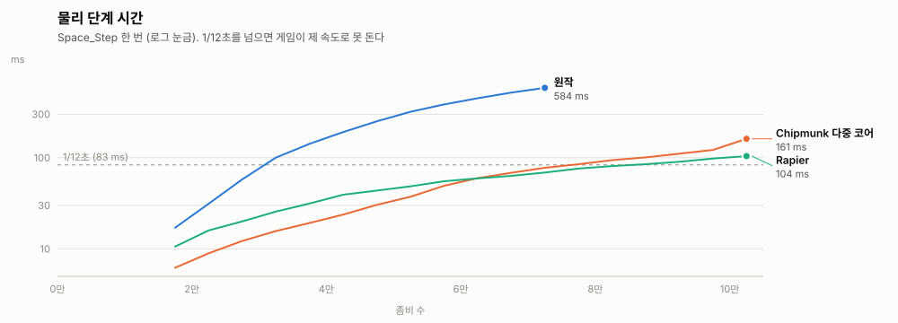
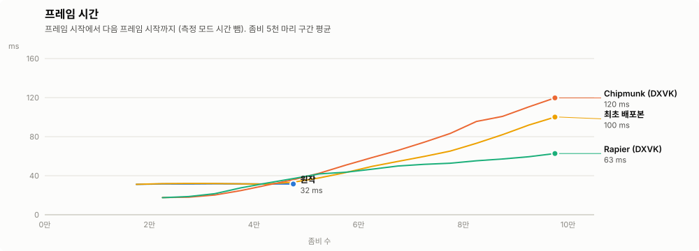
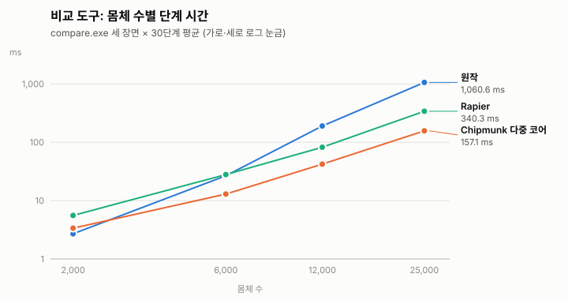
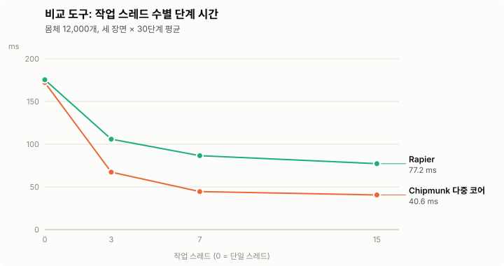

# TheyAreBeer


They Are Billions 최적화 패치 ~~데아-비루~~

치지직 스트리머 **[똘똘똘이](https://chzzk.naver.com/1906dd57f578c255feca54700bcccfc9)** 님이 배포한 **They Are Billions 비공식 최적화 패치 모드**를 수정,개선한 소스 코드 저장소입니다. 
원본 모드 이름은 **TAB 최적화 패치(TABPerf)** 입니다.

대량의 좀비가 등장하는 장면에서 발생하는 끊김과 느려짐을 줄이는 것을 목표로 합니다. 게임 엔진을 보완하는 C# 모드와 여러 CPU 코어를 활용하는 네이티브 물리 DLL로 구성됩니다.

이 저장소에는 패치 소스와 빌드 스크립트가 들어 있습니다. 게임 본체, TABModLoader, 빌드된 설치 패키지는 포함하지 않습니다. 상세한 원본 소스 안내는 [README-SOURCE.txt](README-SOURCE.txt)를 참고하세요.

## 주요 기능

| 영역 | 최적화 내용 |
| --- | --- |
| 물리 연산 | Chipmunk2D 기반 물리 엔진의 위치·속도 계산, 충돌 탐색, 접촉 처리 등을 다중 코어로 처리 |
| 물리 엔진 교체 | 선택 설정으로 물리 엔진을 [Rapier](https://rapier.rs/) 2D로 교체 |
| 물리 호출 | 게임 파일을 바꾸지 않고 모드 폴더의 물리 DLL로 연결하고, 호출마다의 권한 검사를 생략. Rapier 판은 몸체 값을 DLL 호출 없이 직접 읽고 씀 |
| 작업 분배 | 논리·물리 작업을 작은 단위로 나눠 CPU 작업 부하를 분산 |
| 게임 시간 | 게임 옵션의 **빠른 타이머**와 상관없이 실제 경과 시간으로 게임 시계를 돌려, 물리 계산 중 게임이 멈추지 않게 함 |
| 물리 보간 | 물리 단계의 계산 시각에 맞춰 화면에 표시할 위치의 보간 기준을 보정 |
| 그리기 순서 | Z 순서 변경량에 따라 정렬 방식과 갱신 주기를 조절 |
| 좀비 탐색 | 거리 지도를 활용해 도달할 수 없는 대상에 대한 불필요한 적 탐색을 생략 |
| 전력망 | 연결 요소 정보를 활용해 전력 연결 여부를 계산 |
| 소리 | 같은 상태의 소리 장치를 반복해서 켜는 호출을 줄임 |
| 그리기 | 단순한 스프라이트는 렌더러를 거치지 않고 정점을 직접 추가하고, 장면 안의 D3D 장치 확인을 한 번으로 줄이고, 빛·후처리 물체를 보이는 물체 목록 끝에서부터 찾아 지움 |
| 미니맵 | 웨이브 위치를 물리 DLL에서 한 번에 계산 (Rapier 판) |
| 체력바 | 선택 옵션으로 좀비 체력바를 얇은 막대 형태로 단순화 |

성능 개선 정도는 CPU, 맵, 유닛 수와 게임 상황에 따라 달라집니다.

## 빌드 준비

- Windows x64 환경
- Visual Studio 2019/2022 또는 Visual Studio Build Tools
  - 물리 DLL: **C++를 사용한 데스크톱 개발** 워크로드 및 MSVC x64 도구
  - 엔진 모드: **MSBuild 및 Roslyn C# 컴파일러**, .NET Framework 4.7.2 이상
- Rapier 엔진(선택): [rustup](https://rustup.rs/), CMake 3.25 이상, git
- [TABModLoader](https://codeberg.org/JKstring/TABModLoader)의 참조 파일. 아래 세팅 스크립트가 내려받습니다.
  - TABModLoader가 패치한 `TheyAreBillions.exe`
  - TABModLoader 저장소의 `Lib` 폴더에 있는 `DXVision.dll`, `0Harmony.dll`

`ModInfos.json`에 명시된 요구 로더 버전은 `1.1.0`입니다. 네이티브 빌드 스크립트는 경로에 공백이 있으면 중단하므로, 저장소를 공백이 없는 경로에 두세요.

## 빌드와 설치

저장소 루트에서 PowerShell로 실행합니다.

### 0. 세팅 (게임 확인, 참조 파일, 모드로더 패치)

```powershell
powershell -ExecutionPolicy Bypass -File .\scripts\setup.ps1
```

세팅 스크립트는 다음을 순서대로 처리합니다.

1. **게임 설치 확인**: Steam 레지스트리와 `libraryfolders.vdf`, 앱 매니페스트(`appmanifest_644930.acf`)로 They Are Billions 설치 폴더를 찾습니다. 찾지 못하면 `-GameDir`로 지정하세요.
2. **참조 파일**: TABModLoader 최신 릴리스의 `ModLoaderUpdate.zip`에서 패치된 실행 파일을 받아 `refs\TheyAreBillions.exe`로 저장합니다. 로더 저장소의 최신 `Lib\v*` 폴더에서는 `DXVision.dll`과 `0Harmony.dll`을 받습니다. `refs\`는 git이 추적하지 않습니다.
3. **모드로더 패치**: 게임의 `TheyAreBillions.exe`가 로더로 패치됐는지 확인하고, 아니면 패치합니다.
   - 원본은 같은 폴더에 `TheyAreBillions.exe.orig`로 보관합니다. 되돌리려면 이 파일을 `TheyAreBillions.exe`로 되돌려 놓거나, Steam에서 "게임 파일 무결성 확인"을 실행하세요.
   - 다른 버전의 로더로 이미 패치돼 있으면 받은 버전으로 바꿉니다. 이때 보관해 둔 원본은 그대로 둡니다.
   - 게임이 실행 중이면 멈추고 안내합니다. 게임 폴더에 쓸 권한이 없으면 관리자 PowerShell에서 다시 실행하라고 안내합니다.
   - Steam이 게임을 업데이트하거나 무결성을 확인하면 패치가 풀립니다. 그때는 세팅을 다시 실행하세요.

옵션:

- `-NoPatch`: 게임 파일은 건드리지 않고, 패치 상태만 보여 주고 참조 파일만 받습니다.
- `-GameDir <폴더>`: 게임 설치 폴더를 직접 지정합니다.
- `-Version v1.1.6`: 특정 릴리스를 받습니다.
- `-RefDir <폴더>`: 참조 파일을 저장할 폴더를 지정합니다.
- `-Force`: 이미 있어도 다시 받습니다.

### 1. 빌드

```powershell
powershell -ExecutionPolicy Bypass -File .\scripts\build.ps1
```

빌드 스크립트 하나로 물리 엔진과 엔진 모드를 모두 빌드합니다. 일부만 빌드하려면 `-Target`에 대상을 쉼표로 나열하세요(예: `-Target chipmunk,mod`). 대상은 아래 순서로 빌드됩니다.

| 대상 | 출력 파일 | 설명 |
| --- | --- | --- |
| `chipmunk` | `native\out\DXPhysicsNative.dll` | Chipmunk2D를 여러 코어로 계산하는 물리 DLL |
| `harness` | `native\out\compare.exe` | 원작 DLL과 대체본을 함께 돌려 비교하는 도구 |
| `rapier` | `native\out\rapier\DXPhysicsNative.dll`, `rapier2d_ffi.dll`, `rapier2d_ffi_avx2.dll`, `rapier2d_ffi_avx512.dll` | [Rapier](https://rapier.rs/) 2D 엔진으로 동작하는 물리 DLL |
| `mod` | `mod\out\TABPerf.dll`, `mod\out\ModInfos.json` | 엔진 모드 |

- `-Target`을 생략하면(`all`) 모두 빌드합니다. 이때 비교 도구 빌드가 실패하면 경고만 남기고, Rapier에 필요한 도구(git, cmake, rustup)가 없으면 Rapier를 건너뜁니다. 대상을 직접 지정하면 실패를 오류로 처리합니다.
- 엔진 모드는 기본으로 `refs\`의 참조 파일을 씁니다. 다른 폴더는 `-RefDir`로 지정하고, Roslyn 컴파일러를 자동으로 찾지 못하면 `-Csc`로 `csc.exe` 경로를 지정하세요.
- 각 단계의 컴파일 기록은 출력 폴더의 `build.log`, `build-harness.log`, `rapier-build*.log`에 남습니다. 실패하면 오류 줄을 보여 주고 멈춥니다.

Rapier 빌드는 Rapier의 공식 C 바인딩을 [공식 문서](https://rapier.rs/docs/user_guides/c/getting_started_c)의 CMake 빌드로 만들며, 다음 순서로 진행합니다.

1. Rapier 저장소를 고정 커밋으로 `native\out\rapier-src`에 받습니다.
2. `native\rapier\*.patch`를 받은 소스에 적용합니다. 패치 목록이나 내용이 바뀌면 소스를 고정 커밋 상태로 되돌린 뒤 모두 다시 적용합니다.
   - `rapier-c-batch-write.patch`: 여러 몸체의 위치·속도를 한 번의 호출로 쓰는 `r2RigidBody_WriteStates`를 C 바인딩에 더합니다(공식 바인딩은 몸체·값마다 호출해야 하고, 호출마다 세계 잠금과 오류 처리를 거칩니다).
   - `rapier-solver-park.patch`: 병렬 솔버의 작업 스레드가 단계를 기다릴 때 `RAPIER_SYNC_SPIN`번 돈 뒤 잠들게 합니다(래퍼 기본 2000). 게임의 로직·그리기 스레드에 코어를 돌려줍니다.
   - `rapier-solver-stats.patch`: 병렬 솔버의 장벽 대기·넘침 처리 시간과 색 수를 셉니다(`RAPIER_SOLVER_DIAG`가 있을 때만).
   - `rapier-solver-zorder.patch`: 솔버 몸체를 위치의 Morton 순서로(16단계마다), 색 안의 접촉을 몸체 순서로 정렬해 캐시 적중을 높입니다(래퍼 기본 켬, `RAPIER_BODY_SORT=0`·`RAPIER_CONTACT_SORT=0`으로 끔).
   - `rapier-c-step-counters.patch`: 마지막 단계의 Rapier 내부 구간 시간(넓은 범위·좁은 범위 충돌 검사, 섬 제약 수집, 솔버 등)과 접촉 수를 한 번에 읽는 `r2StepCounters`를 더합니다. Rapier의 `profiler` 기능으로 빌드하며, 카운터는 켤 때만 잽니다.
3. 필요한 Rust 버전(1.99.1)이 없으면 설치합니다.
4. `-DRAPIER_DIMENSION=2 -DRAPIER_PRECISION=32 -DRAPIER_ENABLE_PARALLEL=ON -DRAPIER_SIMD_LANES=8 -DRAPIER_FEATURES=profiler`로 세 번 빌드하고 CMake 통합 테스트를 돌립니다. 모든 x64 CPU용, AVX2·FMA용(Rust `+avx2,+fma`), AVX-512용(여기에 `+avx512f,+avx512vl,+avx512bw,+avx512dq,+avx512cd`)이며 모두 8레인 솔버입니다. Rust 쪽은 fat LTO·코드 생성 단위 1개로 빌드합니다(Cargo 환경 변수 `CARGO_PROFILE_RELEASE_LTO=fat`). 빌드 PC가 그 명령어를 지원하지 않으면 그 빌드의 테스트는 건너뜁니다.
5. 같은 정의(`RAPIER_DIM2`, `RAPIER_F32`, `RAPIER_PARALLEL`)로 `DXPhysicsNative.dll`을 빌드합니다. 이 DLL은 CPU와 OS가 지원하는 가장 높은 빌드(AVX-512 → AVX2 → 기본)를 같은 폴더에서 불러옵니다. 파일이 없으면 다음 단계로 내려갑니다.

### 2. 설치

설치 스크립트가 빌드 결과물을 게임의 `Mods\TABPerf`에 넣습니다. 게임 파일은 바꾸지 않습니다. 게임을 끈 상태에서 실행하세요.

```powershell
powershell -ExecutionPolicy Bypass -File .\scripts\install.ps1 -Engine chipmunk
```

```text
<게임 설치 폴더>/
└─ Mods/
   └─ TABPerf/
      ├─ ModInfos.json
      ├─ TABPerf.dll
      ├─ chipmunk/
      │  └─ DXPhysicsNative.dll       # Chipmunk 다중 코어 (native\out)
      └─ rapier/                      # Rapier를 빌드했을 때 (native\out\rapier)
         ├─ DXPhysicsNative.dll
         ├─ rapier2d_ffi.dll
         ├─ rapier2d_ffi_avx2.dll
         └─ rapier2d_ffi_avx512.dll
```

- `-Engine chipmunk|rapier|original`은 `engine.json`의 `physicsEngine`을 함께 정합니다(아래 [물리 엔진 선택](#물리-엔진-선택)). 생략하면 설정을 바꾸지 않습니다.
- 빌드하지 않은 엔진은 건너뜁니다.
- 예전 설치 방식이 남긴 파일을 정리합니다. 모드 폴더 바로 아래의 물리 DLL을 지우고, 게임 폴더에 `DXPhysicsNative.dll.orig`가 있으면 대체본으로 바뀐 게임 폴더의 DLL을 그것으로 되돌립니다.
- 게임이 실행 중이면 멈춥니다. 게임 폴더에 쓸 권한이 없으면 관리자 PowerShell에서 다시 실행하라고 안내합니다.

배포용으로는 `Mods\TABPerf` 폴더를 그대로 묶으면 됩니다. 엔진 DLL은 하위 폴더에 두어야 합니다. TABModLoader는 모드 폴더 바로 아래의 `*.dll`을 모두 .NET 어셈블리로 열어 보므로, 물리 DLL이 그 자리에 있으면 로더 로그에 `加载DLL失败` 줄이 남습니다.

#### 물리 DLL 연결 방식

게임이 물리 DLL을 부르는 선언(`DXVision.DXPhysicsNative`의 `[DllImport("DXPhysicsNative.dll")]`)은 .NET Framework가 게임 폴더의 `DXPhysicsNative.dll`에 연결합니다. 그래서 같은 이름의 DLL을 모드 폴더에 두기만 하면, 미리 불러 두어도 게임은 게임 폴더의 원작 DLL을 씁니다. TABModLoader도 네이티브 DLL은 따로 처리하지 않습니다.

엔진 모드는 게임 파일을 바꾸지 않고, 게임 코드의 물리 호출을 고쳐 이 문제를 피합니다.

1. 고른 엔진의 DLL을 전체 경로로 불러옵니다. 게임 폴더 물리 DLL의 함수가 대체본에 모두 있는지 확인합니다. 게임이 선언만 하고 원작에도 없는 함수 4개는 확인에서 뺍니다.
2. 게임의 선언 47개와 같은 이름, 같은 시그니처, 같은 마샬링의 P/Invoke 메서드를 실행 중에 만듭니다. 이때 `DllImport`에는 대체본의 전체 경로를 씁니다.
3. 게임 어셈블리에서 이 선언을 부르는 메서드(지금 버전은 `DXPhysicBody`와 `DXPhysicWorld`의 36개)를 IL에서 찾습니다. Harmony 트랜스파일러로 호출 대상만 새 메서드로 바꿉니다.

새 P/Invoke 메서드에는 `SuppressUnmanagedCodeSecurity`를 붙여 호출마다의 권한 검사를 생략합니다(`TABPERF_SUCS=0`이면 끔). Rapier 판에서는 위치·속도·힘 등 몸체 값 읽기·쓰기 8종을 DLL을 거치지 않고 몸체 기록에서 직접 처리합니다(`TABPERF_FASTBODY=0`이면 끔). 그래서 호출 비용은 원작보다 작습니다([측정](docs/DEVELOPMENT.md#호출-비용-줄이기)).

한 DLL에서 받은 핸들이 다른 DLL로 넘어가지 않도록, 연결은 전부 되거나 전혀 안 되거나 둘 중 하나입니다. 대체본에 함수가 빠졌거나 패치 하나가 실패하면 모두 되돌리고 게임 폴더의 DLL을 씁니다. 연결 결과는 `billions.log`의 `물리 연결:` 줄에 남습니다. 성능 시험 모드는 끝날 때 게임 폴더의 물리 DLL이 한 번도 불리지 않았는지 확인해 기록합니다.

`Mods\Billions\Billions.dll`이 있으면 같은 최적화를 수행하는 다른 모드가 있는 것으로 판단해 TABPerf는 적용을 건너뜁니다. TABPerf가 여러 폴더에서 중복 로드되는 경우에도 한 번만 적용합니다.

모드를 지우려면 `install.ps1 -Uninstall`을 실행합니다. `Mods\TABPerf`를 지웁니다. `%APPDATA%\TABPerf`의 설정과 로그는 남깁니다. 모드만 잠시 끄려면 게임을 끈 뒤 `Mods\TABPerf` 폴더를 `Mods` 밖으로 옮기면 됩니다.

## 설정과 로그

설정과 로그는 `%APPDATA%\TABPerf`에 저장됩니다.

| 항목 | 설명 |
| --- | --- |
| `billions.log` | 모드 로드, 개별 최적화 적용, 물리 DLL 적용 여부 및 오류 기록 |
| `options.json` | 게임 그래픽 옵션의 **좀비 체력바 가볍게** 설정 저장. 기본값은 꺼짐 |
| `engine.json` | 선택적으로 물리 엔진(`physicsEngine`), 물리 계산 반복 횟수(`physicsIterations`), 빠른 타이머(`fastTiming`), 성능 시험 설정 지정 |
| `dxphysics-crash.txt` | 네이티브 DLL 내부 오류 진단 기록. 저장 폴더가 이미 존재할 때 기록 |

물리 반복 횟수를 직접 지정하려면 `engine.json`에 다음과 같이 작성합니다.

```json
{
  "physicsIterations": 10
}
```

허용 범위는 `1`~`30`이며, 설정하지 않으면 원작의 반복 횟수(기본 10)를 사용합니다. 이 값은 물리 계산 반복 횟수를 바꾸는 고급 설정입니다.

게임 옵션 **FastTimming**이 꺼져 있으면 원작은 물리 계산이 도는 동안 게임 시계를 멈춥니다. 그래서 좀비가 많을수록 게임 전체가 느려집니다(좀비 7만 마리에서 약 0.5배속). 모드는 이 옵션과 상관없이 원작의 빠른 타이머 방식으로 게임 시계를 돌립니다. 게임 옵션 값은 바꾸지 않습니다. 원작 방식으로 되돌리려면 `engine.json`에 `"fastTiming": false`를 넣습니다(환경 변수 `TABPERF_FASTTIMING=0`도 같음).

### 물리 엔진 선택

`engine.json`의 `physicsEngine`으로 물리 엔진을 고릅니다. `install.ps1 -Engine`으로도 정할 수 있습니다. 게임을 다시 시작해야 적용됩니다.

```json
{
  "physicsEngine": "rapier"
}
```

| 값 | 엔진 |
| --- | --- |
| `chipmunk` (기본) | 모드 폴더의 `chipmunk\DXPhysicsNative.dll`. 원작과 같은 Chipmunk2D를 여러 코어로 계산 |
| `rapier` | 모드 폴더의 `rapier\DXPhysicsNative.dll`. [Rapier](https://rapier.rs/) 2D 엔진 |
| `original` | 게임 폴더의 원작 DLL. 모드의 다른 최적화는 그대로 씀 |

고른 엔진을 쓸 수 없으면(파일이 없거나 연결 확인에 실패하면) 로그에 남기고 Chipmunk 판을 씁니다. Chipmunk 판도 쓸 수 없으면 원작 DLL을 씁니다. 어느 엔진이 쓰였는지는 `billions.log`의 `설치 끝 — 물리 DLL:` 줄에서 확인할 수 있습니다.

Rapier 엔진은 원작과 같은 함수로 동작하지만, 계산 방식이 달라 결과가 원작과 똑같지는 않습니다.

- 몸체가 밀리고 겹치는 모양이 원작과 조금 다릅니다.
- 충돌 시작(begin) 콜백이 `false`를 돌려준 쌍은, 원작처럼 같은 단계부터가 아니라 다음 단계부터 무시됩니다.
- 충돌 콜백은 단계 계산이 끝난 뒤 한꺼번에 호출됩니다.
- 센서끼리의 겹침은 감지하지 않을 수 있습니다.
- `Body_SetSize`는 실제로 크기를 바꿉니다. 원작 DLL에서는 움직이는 사각형 몸체의 크기 변경이 다음 단계에 사라집니다.
- 반지름이 있는 질의(`radius > 0`)는 사각형 모서리를 둥글리지 않고 계산합니다.

Rapier 하위 단계(솔버 반복) 수는 게임이 넘기는 값(10, `physicsIterations`로 바꾼 경우 그 값)에서 시작해, 몸체가 몰리는 정도에 따라 5~20 사이에서 자동으로 바뀝니다. 하위 단계가 적으면 몸체가 더 겹쳐 접촉 계산이 늘기 때문에, 몰릴수록 늘리는 편이 빠릅니다.

Rapier 판은 사용하는 CPU에 맞는 빌드(AVX-512 → AVX2 → 기본)를 골라 씁니다. 로그의 물리 DLL 줄에 `Rapier 대체본 (AVX-512)` 또는 `(AVX2)`로 표시되고, 디버그 빌드 Rapier 라이브러리(약 100배 느림)를 불러오면 같은 줄에 경고가 붙습니다.

필요하면 게임 실행 환경의 환경 변수로 동작을 바꿀 수 있습니다.

| 환경 변수 | 뜻 |
| --- | --- |
| `DX_PHYS_THREADS` | 작업 스레드 수(Chipmunk 판과 같음) |
| `DX_RAPIER_ITERATIONS` | 하위 단계 수 고정(1~30) |
| `DX_RAPIER_ADAPT=0` | 하위 단계 자동 조절 끔(게임 값 고정). 범위는 `DX_RAPIER_ADAPT_MIN`·`DX_RAPIER_ADAPT_MAX` |
| `DX_RAPIER_SLEEP=0` | 멈춘 몸체의 잠자기(sleep) 끔 |
| `DX_RAPIER_AVX512=0`, `DX_RAPIER_AVX2=0` | AVX-512 빌드 대신 AVX2를, AVX2 대신 기본 빌드를 씀 |

시험·비교용 스위치(일괄 쓰기, 접촉 강성, CCD, 내부 구간 시간, 접촉 파라미터 등)와 구현 방식은 [개발 문서](docs/DEVELOPMENT.md#rapier-래퍼-구조)에 있습니다.

네이티브 물리 작업 스레드 수는 자동으로 결정됩니다. 필요하면 게임 실행 환경의 `DX_PHYS_THREADS` 환경 변수로 지정할 수 있으며, `0`은 작업 스레드를 끕니다.

## 성능 측정

### 실제 게임 (900% 생존 게임, 마지막 웨이브 4배)

측정 환경: AMD Ryzen Threadripper PRO 7965WX(논리 프로세서 48개), NVIDIA GeForce RTX 3070 Ti, Windows 11, They Are Billions Steam V1.0.14 (64비트), TABModLoader V1.1.6. 2026-11-05, 엔진마다 1회, 모드의 기본 설정(빠른 타이머, 카메라 최대 줌), 물리 DLL은 모드 폴더에서 연결, Rapier는 AVX-512 빌드.

| 항목 | 설정 |
| --- | --- |
| 맵 | 생존 게임, 테마 「부식의 땅」, 감염체 최다(150%), 80일. 점수 배율 900%, 시드 고정(`20261104`)이라 엔진마다 같은 맵 |
| 부하 | 레벨 시작 5초 뒤 피해를 끄고(`CLife.DamageAvailable`, 게임의 디버그 스위치) 마지막 웨이브를 4번 발생. 생성기 4곳, 한 번에 생성기당 약 4,350마리 |
| 진행 | 피해가 없어 좀비가 죽지 않고 지휘본부도 무너지지 않으므로, 좀비가 계속 늘며 지휘본부로 몰립니다(약 10만 2천 마리에서 더 늘지 않음) |
| 기록 | 240초 동안 1초마다 프레임 수·프레임 시간, 물리 단계 수·단계 시간(`Space_Step` 한 번), 좀비 수, 게임 시계 속도 |

"원작"은 게임 폴더의 원작 물리 DLL에 모드의 다른 최적화를 함께 쓴 경우입니다. 좀비가 생성되는 속도는 게임이 얼마나 빨리 진행되느냐에 따라 달라지므로, 그래프는 시각이 아니라 좀비 수(5천 마리 구간 평균)를 가로축으로 씁니다. 각 점에 마우스를 올리면 값이 보입니다(SVG를 직접 열었을 때).


게임 진행 속도는 실제 1초에 게임 시계가 가는 비율입니다. 1.0이면 제 속도(초당 물리 단계 12번)이고, 0.5면 게임 안의 시간이 절반 속도로 흐릅니다. 대량 좀비에서 가장 중요한 지표입니다.

- **원작**은 3만 마리를 넘으면서 급격히 느려집니다. 4만에서 0.4배, 6~7만에서 0.17배(초당 물리 단계 2번)입니다. 그래서 같은 4분 동안 좀비가 7.4만 마리까지만 늘었습니다.
- **Chipmunk 다중 코어와 Rapier**는 6만 마리까지 제 속도를 지킵니다. 그 뒤로는 물리 단계가 1/12초를 넘어 느려지는데, Rapier가 덜 느려집니다. 10만 마리에서 Rapier 0.61~0.65배, Chipmunk 다중 코어 0.45~0.54배입니다.



물리 단계 하나(`Space_Step`)를 계산하는 시간입니다. 세로축은 로그 눈금이라 위로 한 칸 올라갈 때마다 3배 남짓입니다. 점선(83 ms, 1/12초)을 넘으면 물리가 게임 시간을 따라가지 못합니다.

- 6~7만 마리에서 원작은 488 ms, Chipmunk 다중 코어 64 ms(약 7.6배 빠름), Rapier 61 ms(약 8배 빠름)입니다.
- 5만 마리 아래에서는 Chipmunk 다중 코어가 더 빠르고(3만에서 14 대 23 ms), 6만 마리 위에서는 Rapier가 더 빠릅니다(10만에서 104 대 149~176 ms). Rapier는 단계가 가장 길었던 1회도 짧습니다(123~147 대 170~271 ms).



화면 한 장을 그리는 데 걸린 시간입니다. 카메라를 최대로 빼 화면의 좀비를 모두 그리는 조건이라, 좀비 수에 따라 늘어납니다.

- 원작의 프레임이 짧은 것은 게임 진행이 느려 화면에 그릴 좀비가 적기 때문입니다.
- 4~7만 마리에서는 Rapier 판의 프레임이 더 깁니다(5만 42 대 33 ms, 6~7만 73 대 60 ms). 이 구간은 두 엔진 모두 게임이 제 속도라 진행 속도에는 차이가 없습니다.
- 8만 마리를 넘으면 두 엔진 모두 물리 단계(80~120 ms)와 프레임(약 100 ms)이 함께 1/12초를 넘어, 둘 다 게임을 늦춥니다.

<details>
<summary>좀비 수별 표 (구간 안의 초당 기록 평균)</summary>

| 좀비 수 | 엔진 | 표본(초) | 물리 단계/초 | 단계 시간 | FPS | 프레임 시간 | 게임 시간 |
| --- | --- | ---: | ---: | ---: | ---: | ---: | ---: |
| 25,000~35,000 | 원작 | 12 | 10.6 | 82.7 ms | 32.5 | 31.3 ms | 0.89 |
| | Chipmunk 다중 코어 | 10 | 12.2 | 14.0 ms | 32.4 | 31.5 ms | 1.02 |
| | Rapier | 10 | 12.2 | 22.9 ms | 32.7 | 31.2 ms | 1.02 |
| 40,000~50,000 | 원작 | 34 | 4.4 | 226.2 ms | 32.4 | 31.3 ms | 0.37 |
| | Chipmunk 다중 코어 | 12 | 12.2 | 27.1 ms | 31.0 | 33.0 ms | 1.02 |
| | Rapier | 12 | 12.2 | 41.5 ms | 24.5 | 42.4 ms | 1.02 |
| 60,000~70,000 | 원작 | 77 | 2.1 | 487.7 ms | 25.8 | 39.6 ms | 0.17 |
| | Chipmunk 다중 코어 | 13 | 11.9 | 64.3 ms | 17.2 | 59.9 ms | 1.00 |
| | Rapier | 13 | 11.7 | 61.4 ms | 14.3 | 72.9 ms | 0.97 |
| 75,000~85,000 | 원작 | — | — | — | — | — | — |
| | Chipmunk 다중 코어 | 17 | 10.2 | 89.8 ms | 12.7 | 81.9 ms | 0.85 |
| | Rapier | 17 | 10.2 | 78.6 ms | 11.5 | 91.2 ms | 0.85 |
| 90,000~100,000 | 원작 | — | — | — | — | — | — |
| | Chipmunk 다중 코어 | 25 | 8.0 | 116.4 ms | 9.7 | 109.7 ms | 0.67 |
| | Rapier | 23 | 8.8 | 94.2 ms | 10.0 | 106.0 ms | 0.73 |

</details>

<details>
<summary>시간 구간별 표 (웨이브 발생 시점부터, 최대값은 구간 안의 가장 긴 1회)</summary>

| 구간 | 엔진 | 좀비 수 | FPS | 프레임 시간 | 프레임 최대 | 물리 단계/초 | 단계 시간 | 단계 최대 | 게임 시간 |
| --- | --- | ---: | ---: | ---: | ---: | ---: | ---: | ---: | ---: |
| 0~30초 | 원작 | 30,946 | 32.1 | 31.8 ms | 163 ms | 9.6 | 92.7 ms | 180 ms | 0.80 |
| | Chipmunk 다중 코어 | 32,527 | 32.1 | 31.9 ms | 174 ms | 12.2 | 16.3 ms | 59 ms | 1.02 |
| | Rapier | 32,460 | 30.5 | 34.1 ms | 156 ms | 12.3 | 26.7 ms | 46 ms | 1.02 |
| 30~60초 | 원작 | 45,620 | 32.5 | 31.3 ms | 113 ms | 4.4 | 226.1 ms | 278 ms | 0.37 |
| | Chipmunk 다중 코어 | 58,607 | 21.6 | 49.6 ms | 86 ms | 12.1 | 51.0 ms | 80 ms | 1.01 |
| | Rapier | 58,471 | 17.0 | 62.6 ms | 93 ms | 12.0 | 55.0 ms | 73 ms | 1.00 |
| 60~120초 | 원작 | 55,673 | 30.6 | 33.4 ms | 82 ms | 2.8 | 359.4 ms | 435 ms | 0.23 |
| | Chipmunk 다중 코어 | 86,714 | 11.4 | 94.6 ms | 187 ms | 9.3 | 101.5 ms | 170 ms | 0.77 |
| | Rapier | 86,517 | 10.9 | 97.0 ms | 189 ms | 9.6 | 84.8 ms | 147 ms | 0.80 |
| 120~180초 | 원작 | 65,063 | 25.9 | 39.5 ms | 100 ms | 2.1 | 484.0 ms | 546 ms | 0.17 |
| | Chipmunk 다중 코어 | 101,763 | 8.5 | 126.2 ms | 263 ms | 6.4 | 149.0 ms | 271 ms | 0.54 |
| | Rapier | 101,796 | 9.7 | 108.8 ms | 233 ms | 7.8 | 104.2 ms | 127 ms | 0.65 |
| 180~240초 | 원작 | 71,669 | 23.2 | 44.1 ms | 93 ms | 1.7 | 576.3 ms | 627 ms | 0.15 |
| | Chipmunk 다중 코어 | 101,873 | 7.3 | 146.7 ms | 180 ms | 5.4 | 176.2 ms | 212 ms | 0.45 |
| | Rapier | 101,849 | 9.2 | 114.7 ms | 147 ms | 7.3 | 104.3 ms | 123 ms | 0.61 |

</details>

같은 측정은 벤치 스크립트로 바로 할 수 있습니다. 엔진마다 게임을 한 번씩 띄워 자동 시험을 돌리고 결과를 정리합니다. Steam이 켜져 있어야 합니다.

```powershell
powershell -ExecutionPolicy Bypass -File .\scripts\bench.ps1 -Engine chipmunk,rapier,original -Seconds 240
```

결과는 `bench-out\<날짜-시각>\`에 실행별 CSV와 `summary.csv`로 남습니다. 인자, CSV 열, 실험용 환경 변수, `engine.json`으로 직접 실행하는 방법, 결과 읽는 법은 [성능 시험 문서](docs/BENCH.md)를 보세요. 그래프는 `python scripts/charts.py --game <결과 폴더>`로 다시 그립니다.

### 비교 도구 (`compare.exe`, 장면 3개 × 30단계)

게임 없이 물리 DLL만 불러, 같은 장면을 원작 DLL과 나란히 돌립니다. `compare.exe <원작 DLL> <대체본 DLL> all <몸체 수> 30`의 세 장면(몸체가 40×40 영역에서 움직이는 장면 2개, 한쪽으로 몰려가는 장면 1개)의 단계당 평균 시간입니다(2026-11-05).



- 원작은 몸체가 2배가 될 때 단계 시간이 4~7배로 늘어, 2만 5천 개에서 1초가 넘습니다.
- 이 짧고 빽빽한 장면에서는 Chipmunk 다중 코어가 Rapier보다 약 2배 빠릅니다. 몸체가 거의 모두 맞닿아 있어 Rapier가 하나의 큰 섬(island)으로 풀어야 하고, 몰릴수록 하위 단계를 늘리는 자동 조절이 이 장면에서는 단계를 길게 만듭니다(자동 조절을 끄면 1만 2천 개에서 82.0 → 71.2 ms).
- 실제 게임처럼 오래 몰려 있는 장면에서는 자동 조절이 겹침을 줄여 오히려 빠르고, 위 실제 게임 측정처럼 6만 마리 위에서는 Rapier가 더 빠릅니다. 엔진 선택은 실제 게임 측정을 기준으로 합니다.



몸체 1만 2천 개에서 작업 스레드 수만 바꿨습니다. 단일 스레드에서는 두 엔진이 비슷하고(172 대 176 ms), 스레드를 늘리면 Chipmunk 다중 코어가 더 잘 빨라집니다(15개에서 단일 스레드 대비 Chipmunk 4.2배, Rapier 2.3배). 둘 다 7개를 넘으면 거의 더 빨라지지 않습니다.

<details>
<summary>비교 도구 표</summary>

| 몸체 수 | 원작 | Chipmunk 다중 코어 | Rapier (AVX-512) |
| ---: | ---: | ---: | ---: |
| 2,000 | 2.7 ms | 3.4 ms | 5.6 ms |
| 6,000 | 26.7 ms | 13.0 ms | 27.9 ms |
| 12,000 | 190.0 ms | 42.2 ms | 82.0 ms |
| 25,000 | 1,060.6 ms | 157.1 ms | 340.3 ms |

| 작업 스레드 | Chipmunk 다중 코어 | Rapier |
| ---: | ---: | ---: |
| 0 (단일 스레드) | 172.3 ms | 175.5 ms |
| 3 | 67.3 ms | 105.9 ms |
| 7 | 44.5 ms | 86.5 ms |
| 15 | 40.6 ms | 77.2 ms |
| 자동 | 42.2 ms | 82.0 ms |

</details>

## 소스 구성

```text
mod/                   C# 엔진 최적화 모드(TABPerf.dll)와 모드 정보(ModInfos.json)
├─ Core/                진입점과 설치 순서(PerfMod), 설정(engine.json 포함)·로그·시계, 공용 Harmony 도우미
├─ Physics/             물리 DLL 연결, Rapier 몸체 직접 접근, 물리 단계·게임 시간, 논리/물리 병렬 분할
├─ Logic/               좀비 적 찾기, 전력망, 소리
├─ Render/              렌더러 내부 접근(Renderer), 그리기 순서, 체력바와 옵션 창, 그리기 빠른 길, 웨이브 미니맵 표시
└─ Diag/                성능 시험 모드와 계측
docs/
├─ BENCH.md             게임 안 성능 시험 사용법
└─ DEVELOPMENT.md       구현 방식, 측정·실험 결과
native/
├─ chipmunk/            수정된 Chipmunk2D 7.0.0
├─ dxphysics/           게임용 물리 API 래퍼, 작업 스레드 풀, 오류 진단
├─ rapier/              Rapier 물리 DLL (DXPhysicsRapier.c), Rapier 패치 (*.patch: 일괄 쓰기, 단계 카운터, 솔버 대기·진단·몸체 순서)
└─ harness/             원작 DLL과의 비교 도구
scripts/
├─ setup.ps1            게임 확인, TABModLoader 참조 파일 받기(refs/), 모드로더 패치
├─ build.ps1            물리 엔진(Chipmunk·Rapier), 비교 도구, 엔진 모드 빌드 (-Target으로 선택)
├─ install.ps1          빌드한 모드와 물리 엔진을 Mods\TABPerf에 설치·제거
├─ bench.ps1            게임 안 자동 성능 시험을 엔진별로 돌리고 결과 정리 (bench-out/)
└─ lib/
   ├─ game.ps1          게임 폴더 찾기, 모드로더 패치 확인, 파일 해시
   └─ toolchain.ps1     MSVC·csc 찾기, 빌드 명령 실행, 패딩 검사
README-SOURCE.txt      원본 소스 설명 및 구현 상세
LICENSE.txt            패치 코드의 MIT 라이선스
```

물리 DLL을 수정할 때는 `native/dxphysics/dxdiag.c`의 `dx_text_pad`를 유지해야 합니다. TABModLoader가 DLL 시작 주소의 `+0x13B3` 위치에 5바이트를 덮어쓰기 때문에, 해당 공간에 실제 코드가 배치되면 게임이 종료될 수 있습니다. 빌드 스크립트는 두 물리 DLL 모두 링크 맵에서 이 위치를 검사하고, 어긋나면 빌드를 실패시킵니다. Rapier 판은 같은 이유로 Rust 코드를 `DXPhysicsNative.dll`에 정적으로 넣지 않고, 별도의 `rapier2d_ffi.dll`에서 지연 로드합니다. Rust 코드는 일반 `.text` 섹션에 들어가 패딩보다 앞에 놓이기 때문입니다.

비교 도구의 기본 사용법은 다음과 같습니다.

```powershell
.\native\out\compare.exe "C:\Original\DXPhysicsNative.dll" ".\native\out\DXPhysicsNative.dll"
```

추가 인자는 `[장면|all] [몸체 수] [단계 수]`입니다. 원본 소스 안내에 따르면 병렬 옵션 `3`, `5`, `6`, `8`을 끈 조건에서 원작 DLL과 위치·속도의 비트 단위 일치를 확인했습니다. 다만 몸체를 지우는 장면에서는 지운 몸체의 분리 콜백이 한 단계 늦어, 옵션 `4`(지우기 지연)까지 꺼야 같아집니다. 기본 병렬 설정 전체에 대한 동일성 보장을 뜻하지는 않습니다.

DLL 하나만 재는 모드도 있습니다. `compare.exe prof <DLL> [몸체 수] [단계 수] [반복]`은 벽으로 둘러싼 기지로 몰리는 장면의 단계 시간을, `compare.exe ray <DLL> [좀비 수] [단계 수] [광선 수]`는 레이캐스트 시간을 잽니다.

## 제작 및 라이선스

- 제작·배포: **똘똘똘이 (`ddolddolddol-e`)** — [치지직 채널](https://chzzk.naver.com/1906dd57f578c255feca54700bcccfc9)
- 패치 코드: [MIT License](LICENSE.txt), Copyright (c) 2026 ddolddolddol-e
- Chipmunk2D: 별도의 [MIT License](native/chipmunk/LICENSE.txt)
- Rapier: [Apache License 2.0](https://github.com/dimforge/rapier/blob/master/LICENSE). 저장소에 포함하지 않고 빌드할 때 받습니다. 빌드한 `rapier2d_ffi.dll`·`rapier2d_ffi_avx2.dll`·`rapier2d_ffi_avx512.dll`(`native/rapier/*.patch` 적용)을 배포할 때는 이 라이선스 문구를 함께 넣어야 합니다.

MIT 라이선스 조건에 따라 수정 및 재배포할 수 있으며, 저작권 고지와 라이선스 문구를 유지해야 합니다.

They Are Billions는 **Numantian Games**의 게임입니다. 이 패치는 비공식 모드이며 Numantian Games와 제휴하지 않습니다.
