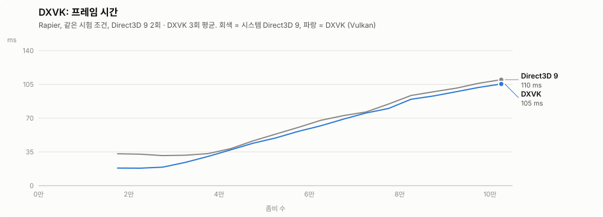
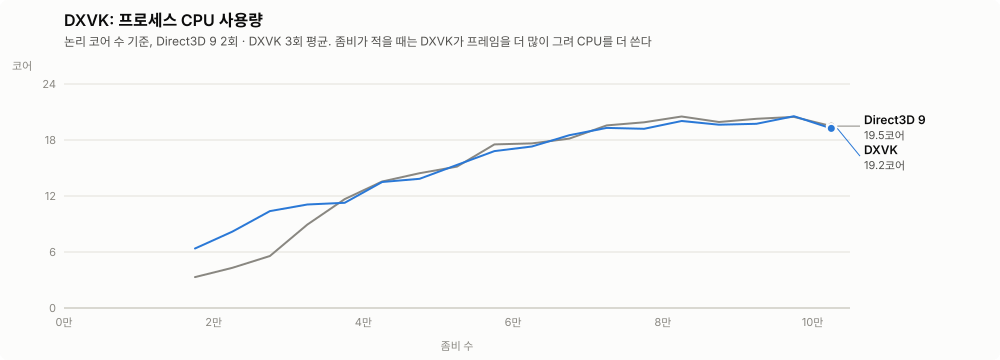
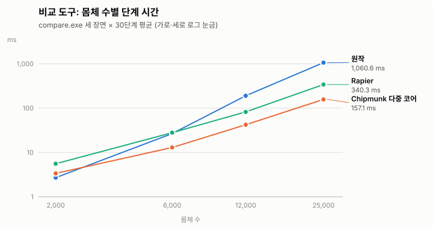
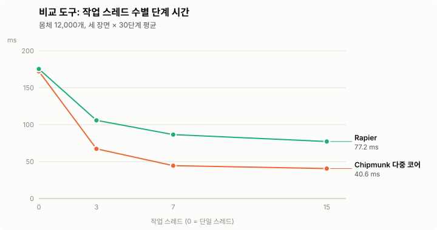

# 개발 문서

구현 방식, 측정 결과, 채택하지 않은 실험을 정리한 문서입니다. 사용자용 설명은 [README](../README.md), 변경 요약은 [CHANGELOG](../CHANGELOG.md), 성능 시험 사용법은 [BENCH.md](BENCH.md)를 보세요.

- [Rapier 래퍼 구조](#rapier-래퍼-구조)
- [Rapier 빌드와 패치](#rapier-빌드와-패치)
- [게임의 물리 호출 경로](#게임의-물리-호출-경로)
- [게임 시계와 로직 갱신](#게임-시계와-로직-갱신)
- [그리기와 웨이브 표시](#그리기와-웨이브-표시)
- [성능 실험](#성능-실험)
- [DX_SetOption 번호](#dx_setoption-번호)

용어: "비교 도구"는 `native\out\compare.exe`, "기지 공성 장면"은 비교 도구의 `prof` 장면을 좀비 5만 마리로 돌린 것(`compare.exe prof <DLL> 50000`, 벽으로 둘러싼 기지로 몰림), "실제 게임"은 [BENCH.md](BENCH.md)의 자동 시험(900% 생존, 마지막 웨이브 4배)입니다. "벽 밖 몸체"는 비교 도구 세 장면에서 방벽 상자 밖으로 밀려난 몸체 수입니다.

## Rapier 래퍼 구조

`native/rapier/DXPhysicsRapier.c`는 게임이 부르는 물리 함수(원작 DLL과 같은 내보내기)를 Rapier 2D로 구현한 `DXPhysicsNative.dll`입니다. Rapier의 [공식 C 바인딩](https://github.com/dimforge/rapier/tree/master/bindings/c)(0.36.1+c.0, 커밋 고정)을 `rapier2d_ffi.dll`로 같은 폴더에 두고 지연 로드합니다.

### 충돌 필터와 콜백
- 충돌 필터는 원작 래퍼와 같은 규칙(분류/마스크 두 방향 중 하나라도 맞으면 충돌)입니다. Rapier 충돌 그룹의 OR 판정 모드로 엔진 안에서 처리하므로, 쌍마다 C 콜백을 부르지 않습니다.
- 충돌 시작·분리 콜백은 Rapier 충돌 이벤트로 만듭니다. 이벤트는 콜백 종류 1인 몸체에만 켜므로, 비용이 접촉 수가 아니라 접촉이 생기고 끊기는 횟수에 비례합니다.
- 충돌 시작 콜백이 `false`를 돌려준 쌍은 분리될 때까지 충격을 계산하지 않습니다. 이 판정에 쓰는 접촉 훅은 무시 중인 쌍이 있는 몸체에만 켭니다.
- Chipmunk처럼 운동학–고정, 운동학–운동학 몸체 사이의 충돌 시작·분리도 알립니다. Rapier는 기본으로 이런 쌍을 건너뛰므로, 콜백 종류 1인 충돌체에만 활성 충돌 종류를 넓힙니다.

### 몸체 상태
- 게임이 매 프레임 읽고 쓰는 위치·속도·힘은 몸체별 원자적 값으로 보관합니다. 그래서 잠금 없이 여러 스레드에서 쓸 수 있고, 다음 단계에 한꺼번에 반영합니다.
- 몸체 잠자기(sleep)를 켭니다. 게임이 같은 값을 다시 쓰면 Rapier에 넘기지 않고, 0에 가까운 속도는 몸체를 깨우지 않고 넘기므로, 멈춘 몸체가 계속 잠들어 있습니다. `DX_RAPIER_SLEEP=0`으로 끕니다.
- 운동학(kinematic) 몸체에도 게임이 정한 속도를 넘깁니다.
- 위치·속도가 유한하지 않게 된 몸체를 Rapier가 격리(quarantine)하면, 마지막 정상 위치에서 정지한 상태로 바로 되살립니다. 게임이 넘긴 NaN·무한대 값은 Rapier에 넘기지 않습니다.
- 상자 모양은 둥근 상자 대신 테두리만큼 키운 일반 상자로 만듭니다. Rapier 문서상 둥근 상자는 충돌 계산이 느립니다(모서리만 0.05 각지고, 질의는 원래 각진 모서리로 계산합니다).

### 단계 앞뒤 처리
- **넣기**: 단계 전 몸체 값(위치·속도·각속도)을 모아 `r2RigidBody_WriteStates` 한 번으로 넘깁니다. 공식 C 바인딩은 값마다 호출해야 하고 호출마다 세계 잠금·오류 처리에 약 270 ns가 드는데, 게임은 거의 모든 좀비에 매 프레임 힘을 주므로 몸체마다 호출이 생겼습니다. 실제 게임 5만 마리에서 넣기 구간이 9.5 ms에서 5.6 ms로, 단계 전체가 60.5 ms에서 56 ms 안팎으로 줄었습니다. 쓰는 순서와 값은 그대로라 결과가 같습니다(비교 도구 3장면, 값 2천만 개씩 일치).
  - 이 함수가 없는 Rapier 라이브러리이거나 호출이 실패하면 값마다 호출합니다. `DX_RAPIER_BATCH=0`으로 끌 수 있습니다(`DX_SetOption(203)`). 일괄 쓰기를 쓰지 못하면 로그의 물리 DLL 줄에 「몸체 값을 하나씩 넘김」이 붙습니다. 내보내기 이름은 `r2RigidBody_WriteStates`이고, 예전 패치 빌드의 `r2RigidBodyWriteStates`도 찾습니다.
  - 넣기 준비(더러운 값·힘 가져오기, 비교, 쓰기 기록 만들기)는 4,096개 묶음으로 작업 스레드에 나누고, 묶음마다 일괄 쓰기를 한 번씩 부릅니다. 충돌 그룹 동기화와 질량 변경은 전처럼 먼저 몸체 순서대로 처리하므로 Rapier에 가는 호출 순서가 같고 결과도 같습니다(비교 도구 3장면 일치). 기지 공성 장면에서 넣기가 8.0 ms에서 5.7 ms로 줄었고, 그중 약 4.9 ms는 Rapier 쪽 일괄 쓰기 자체입니다.
- **가져오기**: 단계가 끝난 뒤에는 Rapier의 활성 몸체 목록에 있는 몸체와, 직전 단계에 깨어 있던 몸체만 한 번에 읽어 옵니다.
- 가져오기와 질의 인덱스의 경계 상자 계산은 작업 스레드로 나눕니다. 실제 게임 6~7만 마리에서 두 구간 합계가 9.2 ms에서 7.5 ms로 줄었습니다.
- 가져오기의 상태 읽기(`r2RigidBodyReadStates`)도 작업 스레드가 자기 몫의 묶음만 읽습니다. 바인딩의 세계 잠금은 읽기끼리 겹칠 수 있고(`Ordinary reads may overlap`), 오류 상태는 스레드마다 따로입니다. 실제 게임에서 가져오기가 좀비 6~8만 마리 4.1 → 1.7 ms, 8만 이상 5.6 → 2.3 ms로 줄었습니다. 단계 전체로는 r2Step의 실행 간 편차(몇 ms)에 묻혀 게임 시간 차이는 보이지 않았습니다.

### 질의 인덱스
- 질의(영역·반경·가장 가까운 몸체·레이캐스트·남은 공간)는 단계마다 다시 만드는 자체 격자 인덱스로 처리합니다. 원작 래퍼와 같은 경계 상자 규칙을 쓰고, Rapier 내부 상태를 건드리지 않아 여러 스레드에서 동시에 불러도 안전합니다.
- 인덱스의 나머지(살아 있는 몸체 압축, 칸마다 개수 세기·채우기)도 작업 스레드로 나눕니다. 칸 채우기는 열 묶음마다 한 스레드가 맡아 원자적 연산이 없고, 칸 안 순서도 그대로라 결과가 같습니다. 기지 공성 장면에서 질의 인덱스가 2.2 ms에서 1.1 ms로 줄었습니다. 처음 만든 원자적 연산·칸별 삽입 정렬 판은 오히려 3.4 ms로 느려서 버렸습니다.
- **새 충돌체의 대기 목록**: 새로 만든 충돌체는 다음 인덱스를 만들 때까지 대기 목록(pending)에 두고, 질의가 이 목록도 봅니다(Chipmunk처럼 만들자마자 질의에 보임). 게임의 공간 질의는 인덱스 락(`g_index`)을 공유로 잡은 채 게임 C# 콜백을 부르기 때문에, 몸체를 만들 때 배타 락을 기다리느라 좀비 6~7만에서 한 번에 100~190 µs가 걸렸습니다. Rapier 삽입 자체는 몸체·충돌체 합쳐 약 1.7 µs입니다. 이제 새 충돌체는 락 없이 붙입니다. 쓰기는 `g_world`로 한 줄로 서고, 항목과 경계 상자를 쓴 뒤 개수를 공개하며, 목록이 자랄 때만 락을 잡습니다. 이미 인덱스에 있는 충돌체를 다시 색인할 때(`Body_SetSize`·`Body_SetAngle`, 게임 코드에서 드묾)는 전처럼 배타 락을 씁니다. 실제 게임에서 물리 스레드의 대기 작업(대부분 몸체 생성)이 단계당 8.8 ms에서 0.2 ms로 줄었고, 비교 도구 세 장면은 원작과 같습니다.

- **레이캐스트**(`Space_RayCast`): 선분을 감싸는 상자의 칸을 모두 훑지 않고, 선분에서 `반지름 + 상자 테두리` 안에 드는 칸만 시작점 쪽 열부터 걷습니다. 가장 가까운 충돌을 찾은 뒤에는 그보다 먼 충돌만 담을 수 있는 열에서 멈춥니다. 후보 조건(상자가 선분 상자와 겹침, 마스크 통과)과, 거리가 같을 때 고르는 몸체(상자 걷기가 먼저 만나는 몸체)는 예전과 같습니다. 인덱스에 카테고리도 함께 담아, 만든 뒤 카테고리가 바뀐 몸체가 없으면 몸체 기록을 읽기 전에 마스크로 거릅니다. 실제 게임에서 두 방식을 함께 돌린 3,300만 번(좀비 10만까지)의 결과가 모두 같았습니다(`DX_RAPIER_RAYWALK=2`).
- **레이캐스트 후보 검사(SIMD)**: 인덱스를 만들 때 칸 항목마다 경계 상자와 카테고리를 칸 순서의 축별 배열로 복사해 둡니다. 광선이 지나는 한 열의 칸들은 연속한 한 구간이 되어, 항목 번호를 거쳐 흩어진 상자를 읽지 않고 차례로 훑습니다. CPU가 AVX2를 지원하면 8개씩 상자·마스크를 한 번에 검사하고(`DX_RAPIER_RAYSIMD=0`이면 같은 검사를 스칼라로), 통과한 항목만 몸체 기록을 읽습니다. 래퍼는 SSE2 기준으로 빌드하고 이 함수만 AVX2 명령을 씁니다. 실제 게임(같은 날, 설정마다 1회), 광선 1회:

  | 좀비 수 | 이전 | 칸 순서 배열(스칼라) | + AVX2 | 광선 CPU(코어) |
  | ---: | ---: | ---: | ---: | --- |
  | 4~6만 | 5.5 µs | 5.0 µs | 2.9 µs | 1.11 → 0.58 |
  | 6~8만 | 7.7 µs | 6.4 µs | 4.2 µs | 1.54 → 0.83 |
  | 8만 이상 | 7.7 µs | 6.0 µs | 2.8 µs | 1.39 → 0.52 |

  두 방식을 함께 돌린 3,400만 번의 결과가 모두 같았습니다. 로직 1회는 8만 이상에서 32.5 → 30.9 ms로 조금 줄었고, 게임 시간은 그대로였습니다(병목은 r2Step). 인덱스 재구성은 배열 복사로 0.3 ms 안팎 늘었습니다.

### 접촉 강성
Rapier 기본 접촉 강성(접촉 스프링 주파수)은 1/60초 단계·하위 단계 4번 기준인데, 게임은 1/12초 단계·하위 단계 10번이라 하위 단계가 두 배 길어 같은 주파수가 두 배 딱딱해집니다. 하위 단계당 강성이 Rapier 기본과 같도록 주파수를 줄이면(하위 단계 10번에서 30→15 Hz, 고정 몸체 접촉 60→30 Hz) 접촉이 덜 튀고 빨라집니다. 밀집 장면 25,000개에서 r2Step이 6~18% 빨라지고, 벽 밖 몸체가 171/189/1539개에서 7/2/343개로 줄었습니다. 하위 단계 수가 바뀌면 같은 규칙으로 다시 계산합니다. `DX_RAPIER_SOFTNESS=0`으로 Rapier 기본값을 씁니다.

### 하위 단계 자동 조절
게임은 `Space_Create`에 Chipmunk 반복 횟수(10)를 넘기고, 래퍼는 이 값을 Rapier 하위 단계 수(`numSolverIterations`)로 씁니다. Rapier 자체 기본값은 4입니다. 하위 단계가 적으면 몸체가 더 겹쳐 접촉이 늘어나므로([하위 단계 수](#하위-단계-수) 실험), 밀집도에 따라 5~20 사이에서 바꿉니다.

- 신호: Rapier가 카운터를 꺼도 세어 두는 접촉 쌍 수(`solve.rs`의 `ncontact_pairs`, `r2StepCounters`의 17번)를 깨어 있는 몸체 수로 나눈 값을 부드럽게(지수 평균 0.3) 따라갑니다.
- 4단계마다 이 값이 3.0보다 크면 하나(30% 넘게 크면 둘) 올리고, 2.2보다 작으면 하나 내립니다. 임계값은 실제 게임에서 고정 값마다 가장 빨랐던 구간의 밀집도(5번 1.2, 10번 2.9, 20번 3.3)에 맞췄습니다. 처음 임계값(4.0 / 3.0, 6단계마다)은 4~5만 구간에서 늦게 올라가 접촉이 쌓였습니다.
- 깨어 있는 몸체가 3,000개보다 적으면 게임 값으로 돌아갑니다.
- `DX_RAPIER_ADAPT=0`이나 `DX_RAPIER_ITERATIONS`는 고정 값을 쓰고, `DX_RAPIER_ADAPT_MIN`·`DX_RAPIER_ADAPT_MAX`로 범위를 바꿉니다. `DX_SetOption(205)`가 `최소*100+최대`(고정이면 0)를 돌려줍니다.
- 실제 게임(카운터 끔, 마지막 30초 좀비 6.8만)에서 단계는 고정 10번 69.5 ms, 자동 65.0 ms(평균 20번), 고정 20번 64.5 ms였습니다. 좀비 수 구간별로는 다음과 같습니다(값마다 1회).

| 좀비 수 | 자동 (평균 하위 단계) | 고정 10 | 고정 20 |
| --- | ---: | ---: | ---: |
| 1~2만 | 11.1 ms (7) | 11.9 ms | 13.0 ms |
| 2~3만 | 19.6 ms (5) | 21.1 ms | 24.5 ms |
| 3~4만 | 29.4 ms (5) | 28.5 ms | 38.7 ms |
| 4~5만 | 41.0 ms (12) | 38.2 ms | 42.2 ms |
| 5~6만 | 51.9 ms (19) | 50.8 ms | 50.8 ms |
| 6~7만 | 61.3 ms (20) | 63.9 ms | 62.0 ms |
| 7~8만 | 68.8 ms (20) | 75.4 ms | 68.3 ms |

### CPU별 빌드 선택
CPUID·XGETBV로 CPU와 OS가 지원하는 가장 높은 빌드(AVX-512 → AVX2·FMA → 기본)를 불러옵니다(지연 로드 훅으로 같은 이름에 연결). AVX-512는 F·VL·BW·DQ·CD와 OS의 마스크·ZMM 레지스터 저장을 확인합니다. `DX_RAPIER_AVX512=0`이면 AVX2까지, `DX_RAPIER_AVX2=0`이면 기본 빌드만 쓰고, 파일이 없으면 다음 단계로 내려갑니다. 로그에는 `Rapier 대체본 (AVX-512)`·`(AVX2)`로 남습니다(`DX_SetOption(201)`이 2·1). 불러온 라이브러리가 릴리스 빌드인지도 확인합니다(`r2BuildProfile`, `DX_SetOption(202)`). 디버그 빌드(약 100배 느림)면 로그에 경고를 남깁니다.

### 내부 구간 시간
- `r2StepCounters`(`rapier-c-step-counters.patch`, `profiler` 기능)는 마지막 단계의 구간 시간과 접촉 수 20개를 한 번에 돌려줍니다: 단계, 사용자 변경, 갱신, 충돌 검사, 넓은 범위, 넓은 범위 마무리, 좁은 범위, 섬 구성, 섬 제약 수집, 솔버, 속도 조립(+하위 2개), 속도 풀이, 속도 갱신, 속도 기록, CCD, 접촉 쌍, 제약, 접촉.
- `DX_RAPIER_COUNTERS=1` 또는 `DX_SetOption(204, 1)`로 켜고 `DX_SetOption(310~329)`로 읽습니다(구간은 µs, 개수는 개수, 단계 합계). 켜면 단계가 약 7%(기지 공성 장면 +2.3 ms) 늘어나므로 기본은 끔입니다. 기능을 넣어 빌드만 한 상태(끔)는 시간 차이가 없었습니다(31.5 대 31.6 ms).
- `compare.exe prof <Rapier DLL>`도 구간과 카운터를 보여 줍니다(`COMPARE_COUNTERS=0`이면 카운터 끔).

### 기타
- `DX_RAPIER_PGS`·`DX_RAPIER_STAB`으로 하위 단계 안의 PGS·안정화 반복 수를 바꿀 수 있습니다(시험용, 기본 1·1).
- 크래시 진단과 모드로더용 코드 패딩(`dx_text_pad`)은 Chipmunk 판과 같은 `dxdiag.c`를 씁니다.
- 엔진 모드는 `DX_SetOption(200)`이 2면 Rapier 판으로 보고 로그에 남깁니다.

## Rapier 빌드와 패치

`scripts\build.ps1 -Target rapier`가 하는 일입니다.

- Rapier 저장소를 고정 커밋으로 받고, 필요한 Rust 툴체인(1.99.1)이 없으면 설치합니다.
- [공식 문서](https://rapier.rs/docs/user_guides/c/getting_started_c)의 CMake 빌드(`-DRAPIER_DIMENSION=2 -DRAPIER_PRECISION=32 -DRAPIER_ENABLE_PARALLEL=ON -DRAPIER_SIMD_LANES=8 -DRAPIER_FEATURES=profiler`)로 C 바인딩을 빌드하고 CMake 통합 테스트(ctest)를 돌립니다. CMake 옵션은 한 표에서 만들어, CMake 인자와 빌드 뒤 캐시 확인이 같은 값을 씁니다.
- 같은 옵션으로 AVX2·FMA 빌드(`rapier2d_ffi_avx2.dll`)와 AVX-512 빌드(`rapier2d_ffi_avx512.dll`)도 만듭니다. 세 빌드 모두 8레인 솔버입니다. 빌드 PC가 그 명령어를 지원하지 않으면 그 빌드의 테스트는 건너뜁니다.
- Rust 쪽을 fat LTO·코드 생성 단위 1개로 빌드합니다(`CARGO_PROFILE_RELEASE_LTO=fat`, `CARGO_PROFILE_RELEASE_CODEGEN_UNITS=1`). 결과는 같습니다(비교 도구 3장면 일치). 비교 도구에서 넣기 구간이 4.3 ms에서 3.7 ms로 줄었고(일괄 쓰기 호출이 인라인됨), r2Step과 실제 게임의 단계 시간은 거의 그대로였습니다.
- `native\rapier\*.patch`를 받은 소스에 적용합니다. 패치의 이름·해시를 `.git\tabperf-patches`에 적어 두고, 목록이나 내용이 바뀌면 소스를 고정 커밋으로 되돌린 뒤(`checkout --force`, `clean -fd`) 다시 적용합니다. 패치가 LF로 맞도록 받은 소스는 `core.autocrlf=false`로 둡니다.
  - `rapier-c-batch-write.patch`: C 바인딩에 `r2RigidBody_WriteStates`를 더합니다. 여러 몸체의 위치·속도·각속도를 한 번의 세계 빌림으로 쓰며, 모든 핸들·값을 먼저 확인한 뒤 씁니다(하나라도 틀리면 아무것도 쓰지 않음).
  - `rapier-c-step-counters.patch`: `rpr_step_counters`(`r2StepCounters`)를 더합니다. [내부 구간 시간](#내부-구간-시간) 참고.
  - `rapier-island-epoch.patch`: 몸체 상태 쓰기와 새 몸체가 활성 집합 세대를 올리지 않게 합니다(`RAPIER_STABLE_EPOCH`). [직렬 구간](#직렬-구간-솔버-그래프와-쌍-등록) 참고.
  - `rapier-pair-prefetch.patch`: 넓은 범위 쌍 이벤트를 처리할 때 몇 이벤트 앞을 미리 읽습니다. [직렬 구간](#직렬-구간-솔버-그래프와-쌍-등록) 참고.
  - `rapier-solver-park.patch`: 솔버 단계 동기화에서 spin 뒤 잠들기. [솔버 대기](#솔버-대기) 참고.
  - `rapier-solver-stats.patch`: 병렬 솔버의 장벽 대기·넘침 처리 시간과 색 수, 단계 안 직렬 구간 시간과 원인 카운터를 셉니다(`RAPIER_SOLVER_DIAG`, `r2SolverDiag`). [병렬 솔버 동기화](#병렬-솔버-동기화), [직렬 구간](#직렬-구간-솔버-그래프와-쌍-등록) 참고.
  - `rapier-solver-zorder.patch`: 솔버 몸체를 Morton 순서로, 색 안의 접촉을 몸체 순서로 정렬합니다. [솔버 몸체 메모리 순서](#솔버-몸체-메모리-순서) 참고.
- 링크 맵에서 `dx_text_pad` 패딩 위치를 검사합니다.

16레인 솔버는 뺐습니다. Rapier는 4·8레인만 있어 `rapier-simd16.patch`(전치 함수, CMake `RAPIER_SIMD_LANES=16`, 통합 테스트)와 simba(`WideF32x16`, `wide::f32x16` 바탕)·parry2d(`simd16`) 크레이트 패치(crates.io에서 받아 SHA-256 확인 후 `[patch.crates-io]`)로 AVX-512 16레인 빌드를 만들었습니다. 16레인은 솔버가 접촉을 묶는 단위가 달라 8레인과 결과가 조금 다르고, 비교 도구 벽 밖 몸체는 4/2/35개에서 4/2/29개였습니다. Ryzen Threadripper PRO 7965WX의 실제 게임에서 r2Step은 8레인 AVX-512와 1% 안쪽으로 같았고 AVX2보다 1~4% 짧았습니다(7만 마리에서 68.5 ms, AVX2 71.3 ms). 비교 도구에서도 8레인과 측정 편차 안쪽이라, 외부 크레이트 패치를 유지할 이유가 없었습니다.

## 게임의 물리 호출 경로

### 연결 방식
게임의 `[DllImport("DXPhysicsNative.dll")]`는 .NET Framework가 게임 폴더의 `DXPhysicsNative.dll`에 연결합니다. 그래서 모드 폴더의 대체본을 먼저 불러 두어도, 게임은 게임 폴더의 원작 DLL을 따로 불러와 썼습니다. TABModLoader도 네이티브 DLL은 처리하지 않습니다(모드 폴더의 `*.dll`을 .NET 어셈블리로만 열어 봄).

- `mod/Physics/PhysicsRedirect.cs`: 게임의 물리 선언 47개를 같은 시그니처·마샬링으로, 대체본의 전체 경로를 가리키는 P/Invoke로 실행 중에 다시 만듭니다. 이 선언을 부르는 게임 메서드(`DXPhysicBody`·`DXPhysicWorld`의 36개)의 호출 대상은 Harmony 트랜스파일러로 바꿉니다. 게임 파일은 바꾸지 않습니다.
- 게임 폴더 DLL의 함수가 대체본에 모두 있는지 PE 내보내기 표로 확인하고, 하나라도 없거나 패치가 실패하면 모두 되돌려 게임 폴더의 DLL을 씁니다. 두 DLL의 핸들이 섞이지 않도록 하기 위해서입니다.
- 실제 게임에서 Rapier와 Chipmunk 모두 확인했습니다. 시험이 끝날 때까지 게임 폴더의 물리 DLL은 불리지 않았고, 단계 시간은 대체본을 게임 폴더에 직접 넣었을 때와 같았습니다.
- 로그의 물리 DLL 표시는 게임이 실제로 부르는 DLL(연결한 대체본, 아니면 게임 폴더의 DLL)에서 `DX_SetOption`을 찾습니다. 전에는 모드가 불러 둔 DLL을 보고 표시해, 게임은 원작을 쓰는데 대체본으로 나올 수 있었습니다.

### 물리 스레드가 하는 일
게임의 물리 스레드는 1/12초(게임 시간)마다 `DXPhysicWorld.UpdateDefaultTime`을 부릅니다(모드에서는 `mod/Physics/PhysicsTime.cs`가 같은 순서로 대신 실행).

1. 대기 작업(`PostMethods`) 실행: 게임 코드가 `DXPhysicWorld.Invoke`로 넣은 작업(몸체 생성, 범주 마스크 변경, 폭발 피해, 위치 이동 등)을 `DXPhysicWorld.Sync`를 쥔 채 하나씩 실행
2. 몸체마다 단계 앞 처리(`StartUpdatePhysics`, `CMovable.MoveToDestiny`): 속도·질량·힘을 읽고 힘을 씀
3. `Space_Step`
4. `DXGame.SyncLogic` 락 대기
5. 몸체마다 위치 되읽기(`OnNewPositionComputed`): 위치(최대 3번)·속도를 읽음

움직이는 좀비 하나당 단계 앞에서 4~6번, 뒤에서 3~4번 P/Invoke가 불립니다. 7만 마리면 단계당 50만 번이 넘습니다. 래퍼의 위치·속도·힘·질량 getter/setter는 메모리를 한두 줄 읽고 쓰는 함수라, 비용 대부분이 전환 자체입니다.

### 호출 비용 줄이기
실제 게임, 좀비 6~8만 마리, ms/단계 (값마다 1회):

| | 바꾸기 전 | SUCS | SUCS + 직접 접근 |
| --- | ---: | ---: | ---: |
| 단계 앞 몸체 처리 | 6.2 | 2.8 | 2.3 |
| 위치 되읽기 | 3.9 | 1.4 | 1.1 |

- **SUCS**: 게임 선언에도, 모드가 다시 만든 선언에도 `SuppressUnmanagedCodeSecurity`가 없어 호출마다 권한 검사가 돌았습니다. 다시 만드는 선언의 형식에 이 특성을 붙입니다(`TABPERF_SUCS=0`이면 끔). 단계 앞뒤 처리 합계가 10.1 ms에서 4.2 ms로 줄었습니다.
- **직접 접근** (`mod/Physics/PhysicsFast.cs`): 게임의 몸체 핸들이 곧 래퍼의 `DxBody` 포인터이므로, Rapier 판에서는 위치·속도·힘·질량·각도·사용자 값 읽기와 힘·속도 쓰기 8종을 DLL 호출 없이 몸체 기록에서 직접 읽고 씁니다. 래퍼와 같은 원자적 읽기·쓰기를 하고, 속도 쓰기는 더러움 표시를 CAS로 겹쳐 씁니다. DLL이 `DX_SetOption(206~216)`으로 기록 배치(판 번호, 크기, 필드 위치, 속도 플래그)를 알려 주고, 모드는 판 번호·맞춤·범위를 확인한 뒤에만 씁니다(`TABPERF_FASTBODY=0`이면 끔). 단계 앞뒤 처리가 약 0.8 ms 더 줄었습니다. 몸체 기록의 필드를 바꾸면 래퍼의 판 번호(206)를 올려야 합니다.

### 대기 작업(PostMethods)
`TABPERF_POSTPROF=1`로 잰 결과(좀비 약 7만까지, 120초): 대기 작업 시간의 99%가 몸체 생성(`DXEntity.CreateBody`, 84,055번 4,184 ms)이었고, 범주 마스크 변경(`ZXEntity.UpdateCategoryMask`)은 148,551번 58 ms였습니다. 몸체 생성 한 번의 래퍼 시간은 처음 1.3 µs에서 좀비 6~7만에서 100~190 µs로 늘었는데, Rapier 삽입은 약 1.7 µs이고 나머지는 질의 인덱스 락 대기였습니다. [새 충돌체의 대기 목록](#질의-인덱스)으로 고친 뒤 대기 작업은 단계당 8.8 ms에서 0.2 ms가 됐습니다.

### 락 대기
물리 스레드가 `DXPhysicWorld.Sync`를 기다린 시간은 0 ms, `SyncLogic`을 기다린 시간은 0.6~0.8 ms였습니다(좀비 6~8만). 몸체 생성(`DXPhysicBody.Create*`)도 `Sync`를 잡지만, 게임은 생성을 대기 작업으로 물리 스레드에서 하므로 서로 막지 않았습니다. 공간 질의는 게임 콜백을 부르는 동안 `g_index`를 공유로 쥡니다.

## 게임 시계와 로직 갱신

### 게임 시계가 멈추던 문제
게임 옵션 FastTimming(`HighPerformanceTiming`)이 꺼져 있으면 원작은 `LoadPhysicsOld` 루프를 씁니다. 물리 스레드가 2 ms 대기마다 게임 시간을 2 ms 올리고, 밀린 물리 단계를 바로 실행합니다. 그런데 `DXTimer.Wait`는 이미 늦은 대기에서 밀린 시간을 버리고 "지금 + 2 ms"를 돌려주므로, 물리 갱신이 도는 동안 게임 시계가 통째로 멈춥니다. 게임 시간 83.3 ms마다 물리 갱신이 한 번 들어가므로 게임 속도는 83.3 ÷ (83.3 + 갱신 ms)배입니다.

| 좀비 수 | 물리 갱신 | 계산 | 측정 (초당 단계) |
| ---: | ---: | ---: | ---: |
| 2만 | 20 ms | 0.81배 | 0.76배 (9) |
| 7만 | 75 ms | 0.53배 | 0.50배 (6) |

로직 갱신(33.3 ms 틱)도 게임 시간을 따르므로 초당 15번(7만 마리)으로 줄었습니다. 이때 로직 쪽은 원인이 아니었습니다: 렌더 스레드는 매 프레임(초당 약 32번) 로직 작업을 띄우고, 이전 작업 대기 0.01 ms, 작업 시작 지연 0.02 ms, 실행 7~12 ms였으며, 초당 15~20개 작업은 처리할 틱이 없어 그냥 끝났습니다. 물리·로직 사용률(`PhysicsUsageFactor`, `IALogicUsageFactor`)도 거의 1 아래였습니다.

FastTimming이 켜져 있으면 원작은 따로 도는 작업이 게임 시간을 올리고(모드의 `mod/Physics/SmoothTime.cs`는 이 루프를 실제 경과 시간으로 돌림), 물리나 로직 사용률(물리: 갱신 ms × 12 × 게임 속도 ÷ 1000, 로직: 갱신 ms × 30 × 게임 속도 ÷ 1000)이 1을 넘을 때만 그 역수로 늦춥니다. 또 물리나 로직이 2틱 이상 밀리면 시계를 세웁니다. 모드는 이제 옵션과 상관없이 이 루프를 씁니다(`engine.json`의 `"fastTiming": false`나 `TABPERF_FASTTIMING=0`이면 게임 옵션을 따름). 옵션 값은 바꾸지 않습니다.

실제 1초당 흐른 게임 시간 (줌 기본, 엔진마다 1회):

| 좀비 수 | FastTimming 끔 | 켬, Rapier | 켬, Chipmunk |
| ---: | ---: | ---: | ---: |
| 2.4만 | 0.75 | 1.00 | 1.06 |
| 4.7만 | 0.62 | 1.03 | 1.03 |
| 6~6.6만 | 0.54 | 0.90 | 0.99 |
| 7~7.2만 | 0.50 | 0.82 | 0.92 |
| 8.2만 | – | 0.64 | 0.81 |

게임이 더 빨리 진행되므로 같은 120초에 좀비가 8.8~9.3만 마리까지 늘었습니다. 이 조건의 시험은 좀비 수 구간으로 비교해야 합니다.

### 로직 따라잡기
렌더 루프는 프레임마다 `DXGame.UpdateGameLogic`을 한 번 부르고, 이것이 띄운 작업은 `SyncLogic`을 잡은 채 밀린 33.3 ms 틱을 모두 돕니다(디컴파일로 확인). 그런데 위 시계 루프는 로직이 2틱 밀리면 시계를 세우므로, 프레임이 66.7 ms보다 길면 작업 하나가 2틱만 돌고 로직 진행이 2 × FPS가 됩니다. 2026-11-05 측정(Rapier)에서 좀비 10만 마리 이상은 9.4 FPS × 2 = 19틱/초, 게임 시간 0.63이었습니다. 물리 사용률은 1.37(물리만 보면 0.73)이었고, 시계를 세운 원인은 모두 로직이었습니다(`l_block_ia_ms` 181 ms/s, `l_block_phys_ms` 0). 6~8만에서도 물리 사용률 0.89인데 로직 때문에 0.93이었습니다.

모드의 시계 루프(`mod/Physics/SmoothTime.cs`)는 이제 로직이 `ceil(프레임 / 33.3) - 1`틱까지 밀려도 시계를 돌립니다. 프레임 시간은 지수 평균(0.2)으로 따라가고, 최대는 `logicMaxLag`(기본 3, `TABPERF_LOGIC_LAG`)입니다. 66.7 ms 이하 프레임에서는 원작과 같은 1틱입니다. 물리 쪽 제한(1단계)은 그대로입니다. 틱마다 게임 시간 33.3 ms로 도는 것은 같고, 한 프레임에 도는 틱 수만 늘어납니다. 로직이 시계보다 더 뒤에 있을 수 있어 명령 반응이 최대 1~2틱 늦어질 수 있습니다.

같은 날 번갈아 4회씩(Rapier, 240초):

| 좀비 수 | 게임 시간 (원작 → 따라잡기) | 프레임 | 물리 단계 |
| ---: | ---: | ---: | ---: |
| 6~8만 | 0.95 → 1.01 | 74 → 75 ms | 68 → 69 ms |
| 8~10만 | 0.80 → 0.87 | 95 → 105 ms | 90 → 91 ms |
| 10만 이상 | 0.67 → 0.74 | 104 → 111 ms | 106 → 111 ms |

- 시계가 로직 때문에 멈춘 시간은 10만 이상에서 0이 되었고, 이제 물리 사용률이 게임 시간을 정합니다.
- 같은 실제 시간에 로직·물리가 더 많이 돌아 프로세스 CPU가 1~1.5코어 늘고, 프레임·물리 단계가 조금 길어졌습니다.
- 물리 스레드가 로직 락(`SyncLogic`)을 기다린 시간은 오히려 줄었습니다(약 7 → 5 ms).
- 한 회차에서 0.7~1초 프레임이 3번 있었지만 나머지 3회에는 없었습니다(최대 약 250 ms, 원작 규칙과 비슷).

### 로직 틱 내부
로직 틱 하나는 시스템들의 `OnStartUpdate`, 모든 엔티티의 `Update`(병렬, 100개씩 묶음), `DXGame.EventOnUpdate`, 시스템들의 `OnFinishUpdate` 순서입니다. 엔티티의 `Update`는 엔티티 자신의 `OnUpdate`를 부르고, 이어 `EventOnUpdate`에 걸린 컴포넌트 처리기를 부릅니다. 컴포넌트 일은 대부분 이 처리기에서 합니다. `TABPERF_TICKPROF=full`(`mod/Diag/TickProf.cs`)로 이것들을 메서드별로 쟀습니다. 처리기는 레벨의 엔티티에서 찾아 5초마다 더합니다.

2026-11-05 측정(Rapier, 240초, 좀비 10만 마리까지). 계측을 켜도 틱 시간은 측정 편차 안이었습니다(10만 이상 틱당 13.4 ms, 끈 시험 11~12 ms).

| 좀비 수 | 틱 (벽시계) | 시스템 | 엔티티 묶음 (모든 스레드 합) |
| ---: | ---: | ---: | ---: |
| 3.4만 | 9.2 ms | 0.3 ms | 182 ms |
| 6.7만 | 12.7 ms | 0.4 ms | 376 ms |
| 10만 | 15.0 ms | 0.5 ms | 509 ms |

- 시스템은 틱의 3% 남짓이고, 틱 시간은 거의 엔티티 갱신입니다. 10만 마리에서 엔티티 일은 CPU 509 ms인데 벽시계는 15 ms라, 논리 프로세서 48개 중 평균 약 34개가 일했습니다.
- 시험 전체에서 엔티티 묶음 CPU 시간(틱당 443 ms)의 몫은 다음과 같습니다.

| 메서드 | 틱당 CPU | 몫 | 호출당 |
| --- | ---: | ---: | ---: |
| `CBehaviour.OnUpdate` (행동 트리, 엔티티마다 2틱에 한 번) | 128 ms | 29% | 1.6 µs |
| `CMovable.OnUpdate` | 64 ms | 14% | 0.8 µs |
| `CLife` 처리기 | 28 ms | 6% | 0.35 µs |
| `Zombie.OnUpdate` (자신, `ZXEntity.OnUpdate` 20 ms 제외) | 23 ms | 5% | 0.3 µs |
| `CInvisibleWhenNotWatched` 처리기 | 22 ms | 5% | 0.28 µs |
| `ZXEntity.OnUpdate` (미니맵 색) | 20 ms | 5% | 0.25 µs |
| `CInflamable` 처리기 | 9 ms | 2% | 0.11 µs |
| 나머지 (호출·이벤트 분배, 메모리 대기, 계측 비용) | 123 ms | 28% | |

- 행동 트리와 이동의 무거운 부분은 `IsIAFrameModule(4)`로 엔티티마다 2틱에 한 번 돕니다(`(틱 + 해시) % 2`). 실제로 도는 틱에서 행동 트리 한 번은 약 3.2 µs입니다.

`full`로 행동 트리의 잎 노드(`ZXBehaviour`의 이름 붙은 노드 람다)와 `CMovable.OnUpdate`의 단계도 쟀습니다. 잎마다 계측이 붙어 틱이 약 25% 길어지고 `CBehaviour`가 128 → 198 ms로 커져서, 아래 값은 비율로만 봅니다(틱당 CPU, 모든 스레드 합).

| 행동 트리 잎 | 틱당 | 틱당 호출 |
| --- | ---: | ---: |
| `IsDied` (`CheckDeath`의 첫 검사) | 14.1 ms | 39,410 |
| `GetNearestEnemy` | 14.0 ms | 116,266 |
| `SelectNormalAttack` | 7.1 ms | 37,688 |
| `GoToPosition` | 5.6 ms | 39,213 |
| `SelectExtraAttack` | 4.5 ms | 37,688 |
| `IsTargetAWall` | 3.9 ms | 39,407 |
| `GetLastEnemyPosition` | 3.3 ms | 37,839 |
| 잎 합계 | 약 53 ms | |
| `CBehaviour.OnUpdate` 전체 | 198 ms | 78,833 |

- 잎의 일을 다 더해도 행동 트리 시간의 약 4분의 1입니다. 나머지는 트리를 도는 비용입니다. 노드마다 `DXNode.Evaluate`가 현재 노드를 바꾸고 `try`로 감싼 대리자 호출을 하고, 조합 노드(`FullSelector`·`FullSequence`·`&`·`|`·`!`)도 각각 대리자입니다. 실행 뒤에는 `OpenNodes`·`RunningNodes` 집합을 정리합니다. 계측 비용을 빼도 행동 트리 시간의 절반 이상이 이 해석 비용으로 보입니다.
- 좀비 루트(`RootZombie`)는 `CheckDeath`, 적 감시·추적, 마지막 적 위치로 달리기, 사령부 공격, 활동 감지, 기본 행동 순서의 선택자입니다. 피해를 끈 시험이라 `CheckDeath`는 늘 실패하고, 대부분 기본 행동까지 내려갑니다.

| `CMovable` 단계 | 틱당 | 틱당 호출 |
| --- | ---: | ---: |
| `FindPath` (가까운 경로만, 2틱에 한 번) | 37.3 ms | 39,073 |
| `GetCurrentSpeed` | 15.3 ms | 78,830 |
| `UpdateTargetAngle` | 9.4 ms | 39,415 |
| `UpdateAngle` | 6.2 ms | 78,830 |
| `CheckJumping` | 3.1 ms | 39,073 |
| `CMovable.OnUpdate` 전체 | 108.7 ms | 78,831 |

- 이동에서는 `FindPath`가 3분의 1 남짓입니다. `GetCurrentSpeed`는 매 틱 불리고 호출당 0.2 µs입니다.

시험 전체로 보면(같은 날 따라잡기 켬 4회, 좀비 10만 이상) 게임 속도를 정하는 것은 물리입니다. 물리 갱신은 초당 8.9번, 한 번에 118.7 ms(이 중 Rapier 단계 99.5 ms)로 물리 스레드가 쉬지 않습니다(사용률 1.43). 로직은 초당 22.3틱, 한 틱 약 12 ms라 벽시계의 약 27%만 씁니다. 로직이 30틱/초를 못 따라가는 것은 좀비가 지금의 2~3배는 되어야 할 것으로 보입니다. 프로세스는 논리 프로세서 48개 중 평균 21개를 썼습니다.

- 줄일 곳: 게임 속도에는 물리 단계(특히 솔버)가 먼저입니다. 로직 쪽은 행동 트리 해석 비용, `FindPath`, `CBehaviour` 잎 중 `GetNearestEnemy` 순입니다. 해석기를 바꾸는 것은 게임의 행동 규칙을 그대로 옮겨야 해서 위험이 큽니다.
- 계측 자체 주의: 처음에는 모든 메서드에 같은 prefix/postfix를 걸고 Harmony의 `__originalMethod`로 메서드를 구분했는데, 이 조회 때문에 호출마다 수 µs가 더 들어 로직이 7~9배 느려지고, 엔티티 `OnUpdate`가 호출당 100 µs처럼 보였습니다. 지금은 메서드마다 번호를 상수로 넣은 prefix/postfix를 만들어(`System.Reflection.Emit`) 씁니다.

### 줌과 프레임
FastTimming 끔 상태에서 줌 최대와 기본을 비교하면(엔진·줌 조합마다 1회, 마지막 30초 좀비 약 7만), 줌 기본은 프레임이 31~33 ms로 줄었지만 초당 단계(6)와 로직 갱신(15)은 그대로였습니다. 줌 최대는 프레임이 56~70 ms였습니다. 즉 그때의 게임 속도는 프레임이 아니라 위 시계 문제가 정했습니다.

### Rapier 판에서 로직·렌더가 느려짐
아래 레이캐스트 수정으로 해결한 문제의 기록입니다. 당시 FastTimming 켬 상태에서 같은 물리 작업 스레드 16개인데도, Rapier 판은 Chipmunk 판보다 로직 갱신과 프레임이 2~3배 느렸습니다. 프로세스 전체 CPU는 비슷합니다(실제 게임, 줌 기본, 설정마다 1회).

| 좀비 수 | 엔진 | 물리 단계 | 프레임 | 로직 1회 | 게임 시간 | CPU 코어 |
| ---: | --- | ---: | ---: | ---: | ---: | ---: |
| 5~6만 | Rapier 자동 | 57 ms | 37 ms | 22 ms | 0.99 | 19.3 |
| | Rapier 고정 10 | 58 ms | 41 ms | 23 ms | 0.99 | 19.0 |
| | Chipmunk | 44 ms | 32 ms | 11 ms | 1.03 | 15.7 |
| 7~8만 | Rapier 자동 | 86 ms | 57 ms | 39 ms | 0.80 | 22.8 |
| | Rapier 고정 10 | 96 ms | 58 ms | 37 ms | 0.74 | 22.2 |
| | Chipmunk | 83 ms | 31 ms | 13 ms | 0.94 | 21.7 |
| 9~10만 | Rapier 자동 | 113 ms | 64 ms | 44 ms | 0.64 | 23.2 |
| | Rapier 고정 10 | 135 ms | 68 ms | 43 ms | 0.55 | 23.4 |
| | Chipmunk | 117 ms | 32 ms | 13 ms | 0.68 | 22.8 |

- 하위 단계 수(자동 평균 20번 대 고정 10번)는 로직·프레임 비용에 영향이 없었습니다. 물리 단계는 자동이 10~16% 빨랐습니다.
- 측정 PC는 물리 24코어·논리 48코어입니다.
- 처음 본 원인 후보: Rapier 솔버의 단계 동기화(`src/dynamics/solver/staged_island_solver/sync.rs`의 `sync`)는 잠들지 않고 `spin_loop`로 기다리다가 1만 번마다 `yield_now`만 합니다. 작업 스레드가 하위 단계의 단계마다 가장 늦은 스레드를 이렇게 기다리면, 같은 물리 코어의 하이퍼스레드에 있는 로직·렌더 스레드를 늦출 수 있습니다. rayon 자체의 대기는 짧습니다(`yield` 33번 뒤 잠듦, rayon-core 1.12.1). 캐시·메모리 대역폭 경쟁일 수도 있습니다.
- 확인 결과(아래 [솔버 대기](#솔버-대기)): 기다리다 잠들게 하면 로직·프레임이 가벼워지지만 일부만 줄어, spin 대기는 원인의 일부입니다.

**주원인: 레이캐스트.** 래퍼 호출을 종류별로 재 보니(`q_*`, `n_*` 열) 로직 스레드의 락 대기는 없었고(`Body_SetAngle`·`SetSize`·`Dispose`·`AddSensor`는 게임 진행 중 불리지 않음, 생성·타입 변경은 물리 스레드의 대기 작업에서 처리), 공간 질의 시간은 거의 전부 `Space_RayCast`였습니다. 게임은 초당 15~20만 번 광선을 쏘는데, 예전 래퍼는 선분을 감싸는 상자의 칸을 모두 훑어 한 번에 인덱스 항목 2,000~5,000개를 보고 그중 3~7개만 상자·마스크를 통과했습니다. 대각선으로 긴 광선의 상자에는 광선이 지나지 않는 좀비 무리가 통째로 들어갑니다(Chipmunk는 경계 상자 트리를 선분을 따라 내려가고 첫 충돌로 범위를 줄임). 광선을 따라 걷게 바꾼 뒤(위 [질의 인덱스](#질의-인덱스)), 같은 날 연속 측정(Rapier, 설정마다 1회):

| 좀비 수 | 광선 1회 | 광선 CPU(코어) | 로직 1회 | 프레임 | 게임 시간 |
| ---: | --- | --- | --- | --- | --- |
| 4~6만 | 25.5 → 5.5 µs | 4.8 → 1.1 | 32.5 → 16.7 ms | 59.6 → 49.9 ms | 0.99 → 1.01 |
| 6~8만 | 42.3 → 7.7 µs | 6.9 → 1.5 | 71.9 → 28.8 ms | 113 → 79 ms | 0.83 → 0.90 |
| 8만 이상 | 56.5 → 7.7 µs | 8.3 → 1.4 | 81.8 → 32.5 ms | 144 → 112 ms | 0.60 → 0.65 |

같은 때 Chipmunk 판은 로직 1회 16.1 / 34.1 / 50.0 ms, 게임 시간 1.02 / 0.95 / 0.57이었습니다. 이 수정으로 로직 비용은 두 엔진이 비슷해졌고, 8만 이상에서 Rapier 판의 게임 시간이 더 빨랐습니다. 그때 남은 차이는 물리 단계 자체였습니다(6~8만에서 Rapier 73 ms, Chipmunk 76 ms이지만 게임 시간은 Chipmunk 0.95 대 Rapier 0.90). 이 날의 측정은 앞 표와 같은 설정에서도 로직·프레임이 더 무거웠습니다. 실행 간 편차가 커서, 비교는 같은 날 연속 측정끼리만 합니다.

## 그리기와 웨이브 표시

물리 단계를 줄인 뒤 좀비 8만 마리 이상에서 프레임(약 100 ms)의 상당 부분이 관리 코드였습니다. 구간을 재 보니 장면 그리기(`DXScene.DrawScene`, 스프라이트마다 렌더러 `DrawObject`)가 프레임당 약 60 ms, 웨이브 미니맵 표시 갱신이 약 10 ms, 렌더러의 D3D 장치 확인이 약 4 ms였습니다. Direct3D 호출 자체는 프레임의 약 8%라서 SlimDX를 SharpDX·D3D11로 바꾸는 것은 효과가 작다고 보고 하지 않았습니다.

### 웨이브 미니맵 표시
`ZXMiniMapIndicatorInfectedSwarn.Update`는 로직 갱신마다 그리기 스레드에서 돌며, 웨이브 유닛 목록에서 죽은 유닛을 지우고(`RemoveAll`) 살아 있는 유닛의 `Cell`(위치를 버림한 칸) 평균에 아이콘을 놓습니다. 웨이브가 10만 마리면 관리 객체를 두 번 따라가는 비용이 큽니다.

- Rapier 판에서는 웨이브의 몸체를 물리 DLL의 몸체 묶음(`DX_GroupNew`·`Add`)에 넣습니다. 묶음 id는 칸 번호와 세대 번호(`slot | gen << 12`)라서 해제된 묶음 id는 거부됩니다.
- `DX_GroupCells`는 묶음을 한 번 훑어, 지워지지 않았고 카테고리가 0이 아닌 몸체의 수와 `(int)x`, `(int)y` 합계를 돌려줍니다. 유닛이 죽으면 `CLife`가 곧바로 몸체 카테고리를 0으로 바꾸고, 몸체는 나중에 지워지므로 이것이 살아 있음의 기준입니다. `Body_Dispose`는 몸체를 묶음에서 뺍니다.
- 아직 몸체가 없는 유닛(`AddUnits` 직후)은 관리 쪽 목록에서 기다렸다가 몸체가 생기면 묶음에 들어갑니다.
- 원작 `Update`는 1초마다, 그리고 살아 있는 유닛이 0일 때 그대로 돕니다. 유닛 목록(저장과 `IsFinished`가 보는 것)이 정리되고, 웨이브 끝도 원작처럼 바로 알아챕니다. 그 뒤 묶음의 수가 목록과 다르면 목록에서 묶음을 다시 만듭니다.
- 검사 모드(`TABPERF_SWARMCHECK=1`): 수는 항상 같았고, 위치는 약 0.8~0.9%에서 한 칸 달랐습니다. 두 계산 사이에 물리 스레드가 몸체를 옮기기 때문입니다.

### D3D 장치 확인
렌더러(`DXPlatform_Desktop.DXRender_SlimDX`)의 `DrawObject`는 스프라이트마다 `D3DCheckDevice`로 `Device.TestCooperativeLevel`(COM 호출)을 부릅니다. `DrawObject`는 Harmony로 고칠 수 없고(예외 블록이 있어 메서드 재작성이 실패), `D3DCheckDevice`는 인라인되어 있어서 SlimDX의 `TestCooperativeLevel`에 걸었습니다. `IDXRenderer.StartScene`부터 `FinishScene`까지 그리기 스레드에서 한 번 성공하면 이후 확인은 그 결과를 돌려줍니다. 장면 시작·끝의 확인과 다른 스레드의 확인은 실제로 합니다. 장면 중간에 장치를 잃으면 D3D 9가 그리기 호출을 무시하고, `FinishScene`의 실제 확인이 예전처럼 알아챕니다.

### 루트 목록 지우기
`DrawScene`의 `finally`는 빛 물체와 후처리 틀을 루트의 보이는 물체 목록에서 `List.Remove`로 지웁니다. 목록 앞부터 `Equals`로 찾으므로 10만 마리에서 약 6.6만 개를 훑고, 빛 물체는 넣지 않은 프레임에도 찾습니다. 두 물체는 `AddObjectToRootAndUpdateVisibleChildren`으로만 들어가고(디컴파일로 확인) Z 순서상 끝 근처에 놓입니다. 넣은 적이 없으면 바로 `false`, 넣었으면 끝부터 찾아 `RemoveAt`합니다. 효과는 프레임의 2% 정도입니다.

### 단순 스프라이트
`DXScene.DrawObject` 안의 렌더러 `DrawObject` 호출 4곳을 `DrawFast.Draw`로 바꿨습니다. 다음 경우만 직접 처리하고 나머지는 원작으로 넘깁니다.

- 묶음을 비우지 않음: 같은 재질, 대기 스프라이트 1만 개 미만, 빛 물체·셰이더 효과 아님, 같은 가위 영역.
- 이미지가 SlimDX `Texture`이고, 마스크·부드러운 테두리·흐림이 없으며 늘이기 방식.
- 바꿀 D3D 상태가 없음: 마지막 효과 없음, 같은 혼합 방식, 같은 알파·감마 상수, 같은 텍스처·필터·방식을 가진 샘플러가 이미 있음.
- 앞의 장치 확인 캐시가 켜져 있고 이번 장면에서 확인이 성공했음(직접 처리하면 장치 확인을 건너뛰므로).

처리 내용은 원작과 같습니다: 샘플러 시간 갱신, 정점 6개(색 행렬, 위치, 텍스처 좌표, Z = 샘플러 번호) 추가, 묶음 상태 갱신. 처음에는 필드를 대리자로 읽어 오히려 느렸고(그리기 60.1 → 66.5 ms), 식 트리(`Expression.Compile`, 비공개 필드 직접 접근)로 한 메서드를 만들어 해결했습니다.

같은 날 연속 측정(Rapier, 설정마다 1회, 그리기는 루트 물체 6만 개 이상, 프레임·게임 시간은 좀비 8만 마리 이상):

| 설정 | 그리기 | 프레임 | 게임 시간 |
| --- | ---: | ---: | ---: |
| 전 | | 108.0 ms | 0.67 |
| 웨이브 표시 + 장치 확인 + 204 대기 없음 | 60.1 ms | 103.8 ms | 0.70 |
| + 루트 목록 지우기 | 59.6 ms | 102.9 ms | 0.70 |
| + 단순 스프라이트 | 53.8 ms | 97.3 ms | 0.72 |

- 스프라이트의 약 70%가 빠른 길로 갑니다. 검사 모드(`TABPERF_FASTDRAW_CHECK=1`)에서 8,160만 번 정점 바이트와 묶음 상태가 원작과 같았습니다.
- 측정 당시 이 구간에서는 물리 단계(약 98 ms)가 프레임과 비슷해, 그리기를 줄인 만큼 다 게임 시간으로 이어지지 않습니다.
- 빛 패스 건너뛰기는 하지 않았습니다. 시험 장면(낮)에서는 전역 조명이 꺼져 빛 패스가 돌지 않고, 다른 맵에서는 물체마다 걸리는 손질 비용(프레임당 약 0.5 ms)만 늘기 때문입니다.

### DXVK
게임의 렌더러(SlimDX)는 `d3d9.dll`을 이름으로 가져옵니다. Windows는 이름으로 부르는 DLL이 이미 프로세스에 올라와 있으면 그 모듈을 돌려주므로, 모드가 `OnLoad`의 맨 처음(물리 연결보다 먼저)에 `<mod>\dxvk\d3d9.dll`을 전체 경로로 불러 두면 게임이 장치를 만들 때 DXVK가 쓰입니다(`mod/Render/Dxvk.cs`). 모드가 실릴 때는 아직 `d3d9.dll`이 없다는 것을 로그로 확인했습니다. 이미 올라와 있으면 아무것도 하지 않습니다. DXVK의 로그는 `DXVK_LOG_PATH`로 `%APPDATA%\TABPerf`에 쓰고, `dxvkMaxFps`는 `DXVK_FRAME_RATE`로 넘깁니다(둘 다 이미 정해져 있으면 그대로 둠).

Direct3D 호출은 프레임의 약 8%였습니다. DXVK는 그 드라이버 일을 따로 도는 스레드로 넘겨 렌더 스레드를 가볍게 하지만, 전체 CPU 일을 줄이지는 않습니다. 측정(Rapier, 240초, Direct3D 9 2회·DXVK 3회, 게임 폴더에 넣은 경우 1회 포함)에서 6만 마리 이상의 프레임은 4~7% 짧았고, 게임 시간과 프로세스 CPU는 실행 간 편차 안이었습니다. 4만 마리 아래에서는 Direct3D 9가 약 32 FPS에 머물던 것이 DXVK에서는 47 FPS 안팎이 되어 CPU가 7코어에서 10코어로 늘었습니다. 그래서 기본은 꺼짐이고, 프레임 제한(`dxvkMaxFps`)을 함께 둡니다. 측정은 다음과 같습니다. 그때의 성능 시험 모드(현재의 진단 기록) CSV로 잰 것입니다.

같은 시험(Rapier, 240초)을 시스템 Direct3D 9로 2번, DXVK로 3번 돌려 좀비 수 구간마다 평균했습니다(2026-11-05, NVIDIA GeForce RTX 3070 Ti, 드라이버 610.88).

- 6만 마리 이상에서 프레임이 4~7% 짧습니다(6~7만 70 → 66 ms, 10만 110 → 105 ms). 그리기 호출을 처리하는 드라이버 일을 DXVK가 따로 도는 스레드로 넘기기 때문입니다.
- 다만 이 구간의 게임 진행 속도는 물리 단계가 정하므로 거의 그대로입니다(차이 0.02 안팎, 한 번 실행의 편차와 비슷).
- 4만 마리 아래에서는 시스템 Direct3D 9가 약 32 FPS에서 멈춰 있던 것이 DXVK에서는 47 FPS 안팎까지 올라갑니다.

- 좀비가 많을 때 전체 CPU 사용량은 거의 같습니다(약 19~20코어). CPU 대부분이 물리·로직·장면 그리기에 쓰이고, Direct3D 호출은 작은 부분이기 때문입니다.
- 좀비가 적을 때는 프레임을 더 그리는 만큼 CPU를 더 씁니다(2~3만에서 약 7 → 10코어). CPU를 아끼려면 `dxvkMaxFps`로 프레임 수를 제한합니다.

## 성능 실험

채택하지 않은 실험도 결과를 남깁니다. 값마다 1회 측정이면 그렇게 적습니다. 같은 조건 두 번 사이 편차는 약 2.5%였습니다.

### 비교 도구 (`compare.exe`, 장면 3개 × 30단계)

게임 없이 물리 DLL만 불러, 같은 장면을 원작 DLL과 나란히 돌립니다. `compare.exe <원작 DLL> <대체본 DLL> all <몸체 수> 30`의 세 장면(몸체가 40×40 영역에서 움직이는 장면 2개, 한쪽으로 몰려가는 장면 1개)의 단계당 평균 시간입니다(2026-11-05).

- 원작은 몸체가 2배가 될 때 단계 시간이 4~7배로 늘어, 2만 5천 개에서 1초가 넘습니다.
- 이 짧고 빽빽한 장면에서는 Chipmunk 다중 코어가 Rapier보다 약 2배 빠릅니다. 몸체가 거의 모두 맞닿아 있어 Rapier가 하나의 큰 섬(island)으로 풀어야 하고, 몰릴수록 하위 단계를 늘리는 자동 조절이 이 장면에서는 단계를 길게 만듭니다(자동 조절을 끄면 1만 2천 개에서 82.0 → 71.2 ms).
- 실제 게임처럼 오래 몰려 있는 장면에서는 자동 조절이 겹침을 줄여 오히려 빠르고, 실제 게임에서는 6만 마리 위에서 Rapier가 더 빠릅니다([README 성능 측정](../README.md#성능-측정)). 엔진 선택은 실제 게임 측정을 기준으로 합니다.

몸체 1만 2천 개에서 작업 스레드 수만 바꿨습니다. 단일 스레드에서는 두 엔진이 비슷하고(172 대 176 ms), 스레드를 늘리면 Chipmunk 다중 코어가 더 잘 빨라집니다(15개에서 단일 스레드 대비 Chipmunk 4.2배, Rapier 2.3배). 둘 다 7개를 넘으면 거의 더 빨라지지 않습니다.

비교 도구 표

| 몸체 수 | 원작 | Chipmunk 다중 코어 | Rapier (AVX-512) |
| ---: | ---: | ---: | ---: |
| 2,000 | 2.7 ms | 3.4 ms | 5.6 ms |
| 6,000 | 26.7 ms | 13.0 ms | 27.9 ms |
| 12,000 | 190.0 ms | 42.2 ms | 82.0 ms |
| 25,000 | 1,060.6 ms | 157.1 ms | 340.3 ms |

| 작업 스레드 | Chipmunk 다중 코어 | Rapier |
| ---: | ---: | ---: |
| 0 (단일 스레드) | 172.3 ms | 175.5 ms |
| 3 | 67.3 ms | 105.9 ms |
| 7 | 44.5 ms | 86.5 ms |
| 15 | 40.6 ms | 77.2 ms |
| 자동 | 42.2 ms | 82.0 ms |

### r2Step 구간
- 기지 공성 장면(카운터 켬, r2Step 약 34 ms): 솔버 15.2 ms(속도 풀이 9.8, 조립 5.4), 충돌 검사 10.2 ms(넓은 범위 7.2, 좁은 범위 3.0), 섬 제약 수집 4.6 ms, 사용자 변경+갱신 2.7 ms.
- 실제 게임 하위 단계 10번(r2Step 72 ms): 솔버 29 ms(속도 풀이 21), 좁은 범위 18 ms, 넓은 범위 12 ms, 사용자 변경 4.4 ms.

- 실제 게임(하위 단계 자동, 카운터 켬, 1회) 좀비 수 구간별:

| 좀비 수 | r2Step | 하위 단계 | 솔버 (속도 풀이) | 좁은 범위 | 넓은 범위 | 접촉 쌍 / 접촉 |
| ---: | ---: | ---: | ---: | ---: | ---: | ---: |
| 2~4만 | 21.8 ms | 5 | 4.6 (3.5) ms | 5.5 ms | 3.4 ms | 5.4만 / 3.4만 |
| 4~6만 | 46.1 ms | 15 | 22.4 (18.7) ms | 8.1 ms | 4.7 ms | 15.5만 / 10.5만 |
| 6~8만 | 70.7 ms | 20 | 45.5 (39.2) ms | 9.9 ms | 5.2 ms | 26.4만 / 18.9만 |
| 8만 이상 | 109.0 ms | 20 | 79.0 (66.5) ms | 16.3 ms | 6.7 ms | 53.6만 / 36.7만 |

  좀비가 많을수록 솔버, 그중 속도 풀이가 대부분입니다. 속도 풀이는 하위 단계 수 × 접촉 수에 비례하고, 접촉은 밀집도와 함께 좀비 수보다 빨리 늘어납니다(7만 → 9만에서 1.3배 대 2배). 접촉 하나를 하위 단계 한 번 푸는 데 스레드 합계 약 140 ns가 들어 병렬 효율이 낮아 보입니다.

### 솔버 설정
실제 게임(카운터 끔, 설정마다 1회, 같은 날 연속; 기본값은 두 번 돌려 단계 차이 1% 안쪽). 물리 단계(ms) / 게임 시간:

| 좀비 수 | 기본 (5~20) | 안정화 반복 0 | 하위 단계 5~10 + 반복 2 | 상한 15 | 상한 30 |
| ---: | --- | --- | --- | --- | --- |
| 4~6만 | 48.0 / 1.01 | 52.2 / 0.99 | 51.3 / 1.01 | 45.9 / 1.01 | 47.6 / 1.01 |
| 6~8만 | 73.8 / 0.90 | 120.7 / 0.66 | 85.6 / 0.83 | 70.7 / 0.88 | 191.7 / 0.45 |
| 8만 이상 | 112.5 / 0.65 | 159.3 / 0.49 | 147.3 / 0.52 | 116.4 / 0.59 | 254.1 / 0.32 |

- 안정화 반복 0(`DX_RAPIER_STAB=0`), 하위 단계를 줄이고 하위 단계당 반복을 늘림(`DX_RAPIER_PGS=2`, 상한 10): 몸체가 더 겹쳐 접촉이 늘고 느려졌습니다.
- 상한 15: 6~8만에서 단계는 조금 짧았지만 게임 시간은 비슷하거나 낮았고, 8만 이상에서는 느렸습니다.
- 상한 30: 하위 단계가 1.5배인데 단계는 2.4배 길어졌고, 프로세스 CPU는 19.5에서 12.7코어로 오히려 줄었습니다. 하위 단계마다 작업 스레드가 서로 기다리는 시간이 크다는 뜻으로 봅니다. 솔버를 더 줄이려면 설정이 아니라 병렬 솔버의 동기화(`staged_island_solver`)를 손봐야 합니다.
- 기본값(자동 5~20)을 그대로 씁니다.

### 병렬 솔버 동기화
`rapier-solver-stats.patch`가 병렬 솔버(`staged_island_solver`)에 진단을 더합니다(`RAPIER_SOLVER_DIAG`가 있을 때만 기록, `r2SolverDiag`, 벤치 열 `s_*`). 하위 단계 하나는 속도 증분 적용, 갱신, 색마다 웜스타트, 색마다 풀이, 위치 적분, 색마다 안정화 풀이로 이루어지고, 단계마다 모든 작업 스레드가 장벽에서 만납니다. 색에 넣지 못한 넘침 제약은 작업 스레드 0이 혼자 풉니다. 실제 게임(작업 스레드 17, 1회):

| 좀비 수 | 하위 단계 | 색 | 묶음(8개) | 넘침 묶음 | 단계당 장벽 | 장벽 대기 / 작업 스레드 시간 | 넘침 처리 |
| ---: | ---: | ---: | ---: | ---: | ---: | --- | --- |
| 2~4만 | 5 | 11.1 | 4,252 | 65 | 약 200 | 23% | 0.2 ms/단계 |
| 4~6만 | 15 | 17.7 | 12,561 | 120 | 약 890 | 25% | 0.9 ms/단계 |
| 6~8만 | 20 | 17.4 | 21,575 | 105 | 약 1,170 | 23% | 1.1 ms/단계 |
| 8만 이상 | 20 | 19.8 | 40,460 | 69 | 약 1,300 | 19% | 0.7 ms/단계 |

- 넘침 제약의 직렬 처리는 단계당 1 ms 안팎이라 병목이 아닙니다.
- 8만 이상에서 작업 스레드 하나는 단계당 약 58 ms를 솔버에서 보내고, 그중 약 11 ms(장벽 하나에 약 8.5 µs)를 기다립니다. 장벽 사이 일은 스레드당 약 36 µs뿐입니다. 장벽 대기에는 잠든 스레드를 깨우는 시간([솔버 대기](#솔버-대기))과 단계 끝의 불균형이 함께 들어 있습니다.
- 대기를 모두 없애도 솔버는 20% 안팎만 줄어듭니다. 나머지는 실제 계산(접촉 1개·하위 단계 1번에 웜스타트·풀이·안정화 합계 스레드 시간 약 135 ns)입니다.

### 솔버 몸체 메모리 순서
접촉 풀이는 SIMD 묶음(접촉 8개)마다 몸체 16개의 속도를 모으고 다시 씁니다. 솔버 몸체 배열의 순서는 섬이 합쳐진 순서이고, 색 안의 접촉 순서는 접촉이 생긴 순서라, 이 읽기·쓰기가 거의 모두 캐시 미스였습니다. `rapier-solver-zorder.patch`:

- **몸체 정렬** (`RAPIER_BODY_SORT=<n>`): `n` 단계마다 깨어 있는 섬의 몸체 목록(= 솔버 몸체 슬롯)을 위치의 Morton(Z-order) 곡선 순서로 다시 놓습니다. 하위 단계 그룹의 재배열과 같은 방식으로 슬롯 번호(`active_set_id`)를 다시 매기고 세대(epoch)를 올려, 순서에 기대는 캐시를 모두 다시 만들게 합니다. 이미 정렬돼 있으면 그대로 둡니다. 몸체 4,096개 미만이거나 하위 단계 그룹이 있으면 하지 않습니다.
- **접촉 정렬** (`RAPIER_CONTACT_SORT=1`): 병렬 색마다 접촉 목록을 복사해 두 몸체 슬롯 중 작은 값 순으로 정렬합니다(rayon). 같은 색의 접촉은 서로 다른 몸체만 건드리므로 색 안의 순서는 결과를 바꾸지 않습니다.
- 래퍼가 두 변수가 없으면 `16`, `1`로 정합니다(`0`이면 끔).

비교 도구 기지 공성 장면(5만, r2Step): 끔 51.0 ms, 몸체만 53.1, 접촉만 51.7, 둘 다(주기 16) 41.6 ms. 하나만으로는 효과가 없습니다(몸체가 공간 순서여야 접촉 순서가 의미를 가짐). 주기 1·4·16·64는 45.7·44.9·42.6·45.2 ms였습니다.

결과는 비트 단위로 같지는 않습니다. 몸체 정렬의 세대 올림이 솔버 접촉 그래프를 처음부터 다시 만들면서 색 배정이 달라질 수 있기 때문으로 봅니다. 비교 도구 1만 2천 개 세 장면에서 값 몇 개가 달랐고, 방벽 밖 몸체는 1/1/4개로 같았습니다.

실제 게임(1회씩, 같은 날):

| 좀비 수 | r2Step 끔 → 켬 | 솔버 작업 스레드 시간/단계 | 게임 시간 |
| ---: | --- | --- | --- |
| 6~8만 | 63.6 → 58.6 ms | | 0.92 → 0.91 |
| 8만 이상 | 97.3 → 87.4 ms | 50.4 → 37.5 ms | 0.67 → 0.67 |

r2Step은 8~10%, 솔버 계산은 26% 줄고 프로세스 CPU도 약 1.5코어 줄었지만, 게임 시간은 그대로였습니다. 8만 이상에서는 프레임(108 ms)이 로직 틱을 막고 있어(`l_block_ia_ms`) 물리가 빨라져도 게임 시계가 따라가지 못합니다. 그래서 다음으로 그리기를 줄였습니다([그리기와 웨이브 표시](#그리기와-웨이브-표시)).

### 하위 단계 수
- 비교 도구에서는 줄일수록 r2Step이 짧았습니다: 10번 31.5, 8번 30.0, 6번 28.5, 4번 27.4, 3번 25.9, 2번 25.2 ms. 벽 밖 몸체는 늘지 않았습니다(10번 1/1/3개, 6번 이하 0/0/0개). 이 장면에는 몸체가 쌓일 곳이 없어 겹침 효과가 드러나지 않습니다.
- 실제 게임(마지막 30초, 카운터 켬)에서는 반대였습니다.

| 하위 단계 | 좀비 수 | 단계 | 접촉 쌍/단계 | 좁은 범위 | 넓은 범위 | 솔버 |
| ---: | ---: | ---: | ---: | ---: | ---: | ---: |
| 3 | 6.2만 | 165.8 ms | 93.7만 | 102.8 ms | 22.0 ms | 39.5 ms |
| 6 | 6.6만 | 99.0 ms | 58.3만 | 40.4 ms | 13.1 ms | 32.5 ms |
| 10 | 6.8만 | 75.4 ms | 37.7만 | 17.9 ms | 8.7 ms | 28.9 ms |
| 12 | 6.8만 | 72.8 ms | 32.7만 | 14.5 ms | 7.7 ms | 30.5 ms |
| 15 | 6.8만 | 66.9 ms | 28.3만 | 11.3 ms | 6.4 ms | 30.9 ms |
| 20 | 6.7만 | 65.7 ms | 24.0만 | 9.0 ms | 5.4 ms | 33.8 ms |
| 25 | 6.3만 | 102.5 ms | 21.4만 | 40.3 ms | 12.1 ms | 36.8 ms |

하위 단계가 줄면 몸체가 더 겹쳐 접촉 쌍과 좁은 범위 충돌 검사가 늘고, 늘리면 솔버가 조금씩 길어집니다. 25번은 접촉 쌍이 가장 적은데 좁은 범위가 40 ms였고 좀비 수도 달라, 원인을 가리지 못했습니다(1회). 이 결과로 [하위 단계 자동 조절](#하위-단계-자동-조절)을 만들었습니다.

### 접촉 파라미터
[통합 파라미터 문서](https://rapier.rs/docs/user_guides/c/integration_parameters)의 접촉 값을 시험용 환경 변수로 바꿀 수 있습니다: `DX_RAPIER_SLOP`(허용 겹침, 기본 0.1, Chipmunk `collisionSlop`과 같음), `DX_RAPIER_PREDICT`(예측 접촉 거리, 0.02), `DX_RAPIER_RECYCLE`(접촉 재사용 거리, 0.05), `DX_RAPIER_MAXCORR`(최대 보정 속도, 3), `DX_RAPIER_WARMSTART`(0~1, 1). 기지 공성 장면에서 기본값(r2Step 31.5 ms)보다 나은 값은 없었습니다. 예측 거리를 늘리면 접촉이 늘어 느려지고(0.1에서 33.2 ms, 0.4에서 46.6 ms), 재사용 거리 0(재사용 끔)은 32.7 ms, 웜스타트 0.5는 32.2 ms에 벽 밖 몸체 8개, 나머지(최대 보정 속도, 재사용 0.15·0.3)는 측정 편차 안쪽이었습니다.

### CCD
- 이 Rapier는 빠른 동적 몸체를 고정 충돌체(벽)에 대해 자동으로 sweep합니다(`max_ccd_substeps = 0`이면 끔).
- **CCD 끄기** (`DX_RAPIER_CCD=0`): 기지 공성 장면에서 r2Step은 그대로였고(31.2 대 31.3 ms) 벽 밖 몸체만 1/1/3개에서 125/85/38개로 늘었습니다. 이전 측정에서는 몸체 6만 개 밀집에서 r2Step이 약 17% 줄었습니다. 켜 둡니다.
- **soft CCD** (`DX_RAPIER_SOFTCCD=<거리>`, 기본 끔): 몸체의 넓은 범위 상자를 속도 방향으로 그 거리까지 늘려 미리 접촉을 만듭니다(별도 sweep 없음). 0.5·1·2 모두 r2Step이 그대로거나 조금 길었고(31.4 대 31.7~32.2 ms) 벽 밖 몸체도 같았습니다. CCD를 끄고 soft CCD만 쓰면 벽 밖 몸체가 140/106/41개로 CCD를 끈 것과 같았습니다. 벽 통과는 속도보다 무리가 미는 힘 때문이라 soft CCD로 막지 못합니다.
- **CCD 나누기** (`DX_RAPIER_CCD_SPLIT=1`, 기본 끔): 좀비(카테고리 `DX_RAPIER_CCD_HARDCAT`, 기본 `0x200000` = 게임의 `ZXBodyMask.Zombie`)를 bullet(`ccd_enabled`)로 만들어 벽과 좀비가 아닌 동적 몸체까지 sweep하고, 나머지 동적 몸체는 soft CCD(`DX_RAPIER_SOFTCCD`, 이때 기본 1)를 씁니다. Rapier는 bullet끼리는 sweep하지 않아(`ccd_solver.rs`) 좀비끼리의 CCD는 만들 수 없습니다. 비교 도구에서 r2Step은 같았지만(31.3 대 31.6~32.3 ms) 유닛이 섞인 장면의 벽 밖 몸체가 3개에서 25~31개로 늘었습니다. 이 Rapier의 hard CCD는 위치만 부딪힌 지점에서 멈추고 속도는 그대로 두므로, 유닛에 막힌 좀비에 무리의 힘이 몰리는 것으로 추정합니다. 실제 게임에서는 단계가 66.6 ms에서 64.9 ms로 측정 편차 안쪽이었습니다.

### 작업 스레드 수
FastTimming 켬, Rapier 판, 줌 기본, 설정마다 1회. 자동 값은 물리 코어 수 − 1, 최대 16이고 Rapier는 단계를 도는 스레드를 하나 더 씁니다.

| 좀비 수 | 스레드 | 물리 단계 | 프레임 | 로직 1회 | 게임 시간 |
| ---: | ---: | ---: | ---: | ---: | ---: |
| 6~7만 | 16 (자동) | 74.7 ms | 48.5 ms | 32.0 ms | 0.92 |
| | 8 | 90.2 ms | 42.6 ms | 24.9 ms | 0.81 |
| | 4 | 108.7 ms | 35.4 ms | 17.9 ms | 0.71 |
| 8~9만 | 16 (자동) | 106 ms | 56 ms | 37 ms | 0.68 |
| | 8 | 128 ms | 49 ms | 30 ms | 0.60 |
| | 4 | 158 ms | 35 ms | 18 ms | 0.50 |

스레드를 줄이면 로직·프레임은 가벼워지지만 물리가 더 느려져 게임 시간이 덜 흐릅니다. 자동 값을 그대로 씁니다. 4~5만 마리 이하에서는 세 설정 모두 1배속이었습니다.

### 솔버 대기
`rapier-solver-park.patch`는 솔버 단계 동기화(`staged_island_solver/sync.rs`)에서 `RAPIER_SYNC_SPIN`번 spin한 뒤 `park`로 잠들고, 단계를 넘기는 스레드가 잠든 스레드를 깨우게 합니다. 대기자는 락 안에서 등록하고 `published`를 다시 본 뒤 잠들므로 깨움을 놓치지 않고, 500 µs 시간 제한을 둡니다. 변수가 없거나 0이면 원래대로 spin만 합니다. 래퍼는 Rapier DLL을 불러오기 전에 이 변수가 없으면 `2000`으로 정합니다.

비교 도구(기지 공성 5만, 다른 부하 없음) r2Step: spin 33.1 ms, 200번 뒤 잠듦 41.5 ms, 2000번 뒤 잠듦 34.4 ms. 세 장면 결과는 모두 원작과 같습니다.

실제 게임(Rapier, 줌 기본, FastTimming 켬, 설정마다 1회), spin / 200 / 2000:

| 좀비 수 | 물리 단계 | 프레임 | 로직 1회 | 게임 시간 |
| ---: | --- | --- | --- | --- |
| 5~6만 | 59.8 / 65.7 / 56.9 ms | 37.5 / 36.4 / 34.4 ms | 22.1 / 19.8 / 18.9 ms | 1.01 / 1.00 / 0.99 |
| 6~7만 | 76.1 / 82.8 / 71.7 ms | 48.6 / 41.8 / 40.2 ms | 31.6 / 25.0 / 25.5 ms | 0.89 / 0.88 / 0.93 |
| 7~8만 | 92.2 / 99.9 / 85.6 ms | 52.5 / 45.7 / 52.5 ms | 34.9 / 28.3 / 35.9 ms | 0.78 / 0.76 / 0.83 |
| 8~9만 | 105 / 116 / 100 ms | 59.6 / 49.1 / 54.6 ms | 40.2 / 30.5 / 36.9 ms | 0.68 / 0.64 / 0.71 |

- 너무 일찍 잠들면(200번) 깨우는 비용으로 단계가 7~10% 늘어 게임 시간이 오히려 줄었습니다.
- 2000번은 게임 안에서 단계도 4~6% 짧았고 게임 시간이 3~6% 빨랐습니다. 1회 측정이라 편차 범위와 크게 다르지 않을 수 있습니다.
- 이때도 Chipmunk 판의 로직 1회(13 ms)와는 차이가 컸습니다. 주원인은 뒤에 찾은 레이캐스트였습니다([Rapier 판에서 로직·렌더가 느려짐](#rapier-판에서-로직렌더가-느려짐)).

### 질의 인덱스를 단계 밖에서 만들기
단계 뒤 질의 인덱스 다시 만들기(좀비 10만에서 약 4 ms)를 별도 스레드로 옮겨, 물리 스레드가 그동안 게임 쪽 일(로직 락 대기, 위치 되읽기, 다음 단계 준비)을 하게 해 봤습니다. 다음 단계와 단계 뒤의 질의는 새 인덱스를 기다리게 해 비교 도구 결과는 같았습니다(3장면, 몸체 300·5만). 실제 게임(번갈아 2회씩)에서 물리 갱신은 10만 이상 120.5 → 119.6 ms, 게임 시간 0.735 → 0.74로 편차 안이었고, 6~8만에서 물리 스레드의 로직 락 대기가 5 → 7~8 ms로 늘었습니다. 로직의 질의가 인덱스를 기다리는 만큼 물리가 로직을 다시 기다리기 때문입니다. 넣지 않았습니다.

### 2026-11-05 단계 구성 다시 재기
로직 따라잡기를 켠 뒤 카운터를 켜고(`-Counters`, `RAPIER_SOLVER_DIAG=1`) 다시 쟀습니다(1회, 카운터 비용 약 7% 포함). 좀비 10만 이상, 하위 단계 20번:

| 구간 | 시간 |
| --- | ---: |
| r2Step | 105.0 ms |
| 솔버 | 63.9 ms |
| &nbsp;&nbsp;속도 조립(작업 스레드 시작 전 준비: 색 구간·묶음 배치·접촉 정렬 등) | 16.7 ms |
| &nbsp;&nbsp;속도 풀이(작업 스레드) | 47.2 ms |
| 좁은 범위 | 15.6 ms |
| 넓은 범위 + 마무리 | 5.7 + 3.2 ms |
| 섬 제약 수집 | 5.7 ms |
| 사용자 변경 · 갱신 | 3.6 · 3.1 ms |

- 접촉 36만 개(쌍 53만), 색 20.6개, 단계당 장벽 약 1,370번. 작업 스레드 하나가 단계당 풀이 46.8 ms, 장벽 대기 11.0 ms(19%)입니다. 접촉 하나를 하위 단계 한 번 푸는 데 스레드 시간 약 110 ns입니다.
- 하위 단계마다 단계 수는 `3 × 색 + 3`입니다(속도 증분, 갱신, 색별 웜스타트, 색별 풀이, 적분, 색별 안정화). 접촉 색은 단계가 바뀌어도 유지되고(`keep_or_pick`), 고정 몸체와의 접촉은 위쪽 색 대역을 따로 씁니다.
- 게임 속도 1.0에는 물리 갱신이 83 ms 안이어야 해서, 10만 마리에서 약 35 ms를 더 줄여야 합니다.

### 솔버 작업 스레드 우선순위
로직 작업(10만 마리에서 틱마다 순간적으로 스레드 30여 개)이 솔버 작업 스레드를 밀어내면 장벽에서 모두가 기다리므로, 래퍼에서 단계 스레드와 Rapier 풀 스레드(`rapier-worker-N`)의 Windows 우선순위를 올려 봤습니다(보통보다 높음). 번갈아 2회씩, 좀비 10만 이상에서 r2Step 98.7 → 95.5 ms였지만 같은 설정 2회 사이 차이(91.6 대 99.2 ms)가 더 컸고, 로직 작업이 35.7 → 39.2 ms로 길어져 물리의 로직 락 대기가 4.1 → 6.9 ms로 늘었습니다. 물리 갱신 전체(117 → 118 ms)와 게임 속도(0.75)는 그대로라 넣지 않았습니다.

### 직렬 구간: 솔버 그래프와 쌍 등록
`rapier-solver-stats.patch`에 단계 안 직렬 구간 타이머와 원인 카운터를 더해(`RAPIER_SOLVER_DIAG=1`, 벤치 `s_*` 열) 좀비 10만 이상에서 쟀습니다.

| 구간 | 시간 | 내용 |
| --- | ---: | --- |
| 속도 조립 | 16.6 ms | 이 중 10.6 ms는 Rapier 카운터를 켤 때만 도는 접촉 수 통계(접촉 36만 개를 한 번 더 훑음). 실제로는 약 6 ms |
| &nbsp;&nbsp;묶음 배치 | 4.2 ms | 거의 모두 색 안 접촉 정렬(`RAPIER_CONTACT_SORT`) |
| 좁은 범위 | 15.8 ms | |
| &nbsp;&nbsp;쌍 등록 | 7.4 ms | 직렬. 넓은 범위가 낸 쌍 추가 약 5,000개·삭제 약 5,000개 처리 |
| &nbsp;&nbsp;쌍 갱신 | 7.7 ms | 병렬 |
| 섬 제약 수집 | 5.7 ms | 거의 모두 솔버 접촉 그래프 유지 |

[내부 구간 시간](#2026-11-05-단계-구성-다시-재기)의 "속도 조립 16.7 ms"는 대부분 카운터 비용이었습니다.

**솔버 접촉 그래프 재구성.** 솔버 접촉 그래프는 활성 집합의 세대(epoch)가 바뀌면 처음부터 다시 만들고, 아니면 이번 단계에 바뀐 쌍(단계당 약 6,000개)만 고칩니다. 그런데 매 단계 다시 만들고 있었습니다. Rapier의 `IslandManager::rigid_body_updated`는 사용자가 건드린 몸체마다 세대를 무조건 올리는데, 게임은 매 단계 거의 모든 몸체(10만 개)의 상태를 써 넣기 때문입니다. 세대를 올린 호출을 종류별로 세어 보니, 위치·속도 외에 충돌체·질량 변경이 단계당 약 500번, 새 몸체가 스폰 중 단계당 50~90번이었고, 잠들기·깨어나기는 0.1번이었습니다.

`rapier-island-epoch.patch`(`RAPIER_STABLE_EPOCH`, 래퍼 기본 `1`)는 활성 집합의 슬롯이나 동적 여부가 바뀔 수 있을 때만 세대를 올립니다: 타입·켜기 변경, 아직 섬에 없는데 깨어 있는 섬이 없는 새 몸체. 위치·속도·잠들기 표시·충돌체·질량 변경은 소속을 바꾸지 않고, 섬을 합치는 깨어나기는 그 경로가 직접 세대를 올리며, 고정 몸체는 활성 집합에 없습니다. 깨어 있는 섬 끝에 붙는 새 몸체는 다른 슬롯을 그대로 두므로 목록에 적어 두고, 솔버 그래프 유지가 몸체 표(`body_qualify_info`)에 그 항목만 더합니다.

- 재구성이 단계당 1회에서 0.27회가 됐습니다. 남은 것은 16단계마다의 몸체 Morton 정렬과 섬이 잠들거나 깨는 경우입니다. 그래프 유지가 6.1 ms에서 2.0 ms로 줄었습니다.
- 진단을 켠 실제 게임(번갈아 2회씩)에서 좀비 10만 이상 r2Step이 103.4 → 98.5 ms, 물리 갱신이 121.4 → 117.0 ms였고, 4만~8만에서도 2.5~3 ms씩 짧았습니다. 진단을 끄고(쌍 등록 프리페치 포함) 켬 2회·끔 1회를 돌렸을 때는 6만~8만에서 1~2 ms 짧았지만, 10만에서는 96.2·98.9 대 97.9 ms로 같은 설정 사이 차이 안쪽이었습니다(끔 2회째는 중단).
- 결과는 비트 단위로 같지 않습니다. 버킷 안 접촉 순서가 달라지기 때문입니다. 비교 도구 1만 2천 개 세 장면에서 방벽 밖 몸체는 0/1/3개에서 0/1/1개였습니다. Rapier 라이브러리 테스트 67개가 통과했습니다(디버그 빌드의 몸체 표 검증 포함).

**쌍 등록.** 이벤트 하나에 약 720 ns가 들었습니다. 이벤트마다 두 충돌체, 그 그래프 인덱스, 그래프 노드, 노드의 간선 목록을 처음 읽는데, 앞 값이 있어야 다음 주소를 알 수 있어 DRAM 미스가 줄줄이 이어집니다. 이벤트끼리는 독립이라 `rapier-pair-prefetch.patch`는 몇 이벤트 앞을 세 단계로 미리 읽습니다(12개 앞 충돌체·그래프 인덱스, 8개 앞 노드, 4개 앞 목록 첫 간선). 처리 순서와 결과는 그대로입니다(비교 도구 세 장면 값 일치). 진단 타이머를 켠 상태에서 쌍 등록이 14.0 ms에서 9.9 ms로, 그중 삭제 쪽 조회·찾기·연결 해제가 2.0 ms에서 0.6 ms로 줄었습니다.

해 보고 넣지 않은 것(모두 결과는 같았음):
- 쌍 재사용 풀 2,048 → 65,536개: 삭제는 빨라졌지만 다시 쓰는 쌍을 비우는 비용으로 추가가 느려져 합계가 그대로였습니다.
- 그래프 간선의 연결(next·prev·끝점)을 쌍 데이터에서 떼어 작은 배열(간선당 24바이트)로: 간선 찾기가 5.1 → 4.3 ms에 그쳤습니다.
- 간선 찾기에서 두 끝점의 목록을 번갈아 걷기, 넓은 범위가 처음 알린 쌍은 찾기 자체를 건너뛰기: 둘 다 차이가 없었습니다. 추가 쪽 남은 비용(약 700 ns)은 찾기가 아니라 충돌체와 노드의 첫 읽기입니다.
- 접촉 정렬을 키 계산·정렬·모으기 모두 병렬로: 색마다 병렬 호출을 하면 3.7 → 7.2 ms로 느려졌고(호출마다 풀을 깨움), 전체를 한 번에 정렬하고 키를 미리 읽어도 3.6~4.0 ms로 그대로였습니다. 키를 읽는 랜덤 접근(쌍 → 매니폴드)이 비용입니다.

### 16레인 솔버, LTO
[Rapier 빌드와 패치](#rapier-빌드와-패치)를 보세요.

## DX_SetOption 번호

Rapier 판 `DX_SetOption(name, value)`:

| 번호 | 뜻 |
| --- | --- |
| 0 | 작업 스레드 수 지정(-1 자동), 적용된 값을 돌려줌 |
| 100 | Chipmunk 판의 마지막 단계 색 수. Rapier 판은 항상 0 |
| 200 | 엔진 번호(2 = Rapier) |
| 201 | 불러온 Rapier 빌드(0 기본, 1 AVX2, 2 AVX-512) |
| 202 | 1이면 릴리스 빌드 |
| 203 | 1이면 일괄 쓰기 사용 |
| 204 | 단계 카운터 켜기(1)·끄기(0)·확인(-1, 단계 중에도 기다리지 않음), 1이면 재는 중 |
| 205 | 하위 단계 자동 조절: 최소×100+최대, 고정이면 0 |
| 206~216 | 몸체 기록 배치: 판 번호, 크기, pos·vel·force·angle·dirty·type·mass·user 위치, 속도 더러움 플래그 |
| 300~309 | 단계 구간(µs 합계): 넣기, r2Step, 가져오기, 접촉 쌍, 질의 인덱스, 단계 수, 격리 몸체, 몸체 쓰기 수, 하위 단계 합, 접촉 쌍 합 |
| 310~329 | Rapier 내부 구간(µs 합계)과 개수(17 접촉 쌍, 18 제약, 19 접촉) |
| 330~336 | 몸체 생성 시간(µs), 생성 수, 타입 변경 시간, 타입 변경 수, Rapier 몸체 삽입, 충돌체 삽입, `g_index` 대기 |
| 340~352 | 래퍼 호출 진단: `Body_SetAngle`·`SetSize`·`Dispose`·`AddSensor` 시간(µs)·수, 인덱스 재생성 때 대기 목록 합·재생성 수, 광선 검사 차이(거리 다름·같은 거리), 카테고리 변경 수 |
| 356 | 시간 재는 진단(340~347, 360~395) 켜기(1)·끄기(0)·확인(-1). 질의마다 시계를 읽으므로 기본은 끔이고 벤치가 켬 |
| 360~395 | 질의 종류별(영역·반경·반경 배열·가장 가까운·광선·남은 공간) 6개씩: 호출 수, 합계·락 대기·콜백 시간(µs), 본 항목 수, 통과 수 |
| 399 | 300번대 누적값 초기화 |
| 400~409 | 병렬 솔버 진단: 400이 `r2SolverDiag` 값을 가져오고(초기화), 401~409가 읽음. 장벽 대기(µs), 장벽 수, 넘침 처리(µs), 작업 스레드 시간(µs), 색·넘침 묶음·묶음·작업 스레드(풀이마다 합), 풀이 수 |

그 밖의 내보내기: `DX_GroupNew`·`DX_GroupFree`·`DX_GroupAdd`·`DX_GroupCells`(몸체 묶음, [웨이브 미니맵 표시](#웨이브-미니맵-표시)).
